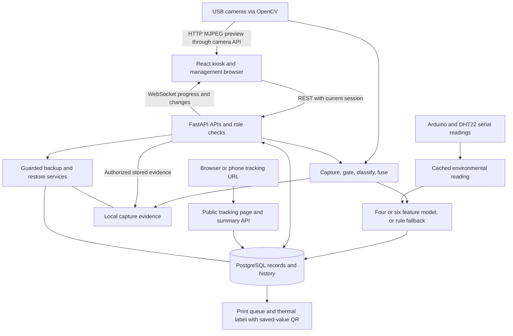

# Capstone Pre-Defense System Review

Review date: **2026-11-02**. Repository: **BananaVision**, branch `main`, source checkpoint `0964ea9`.

This report executes [the supplied review prompt](docs/Capstone_Full_System_Pre_Defense_Review_Prompt.md). It reviews existing behavior and proposes fixes; it does not change application code or the approved research scope. Three focused reviews covered research/ML/IoT, backend/security/data, and frontend/user flows, followed by integration and automated verification.

## 1. Overall Verdict

- **Defense readiness: Cannot assess yet.**
- **Why:** The repository contains a substantial working implementation, rather than only interface mockups. However, approved research objectives, an accepted shelf-life endpoint, and independent results for the current complete pipeline were not available in the reviewed material. Several confirmed problems affect input handling, prediction transparency, and the accuracy of the defense instructions. Passing software tests alone would not establish banana recognition or shelf-life accuracy. Resolve or clearly disclose the P1 findings before presenting the current claims as verified.
- **What was actually reviewed:** Source for React pages/providers/API clients; FastAPI routes, authentication, services and WebSockets; SQLAlchemy models, Alembic migrations through `0011_device_scan_links`, and the current SQL reference; camera/sensor/model integration; label generation; backup/restore and maintenance boundaries; backend and browser-test fixtures. Documentation included `CAPSTONE_SUMMARY.md`, `SOFTWARE_SPECIFICATION.md`, `HARDWARE_SPECIFICATION.md`, `USER_GUIDE.md`, `KIOSK_DEMO.md`, relevant presentation scripts, dataset/model audit reports, approved maintenance design/plan, and relevant notes in `docs/knowledge/`.
- **What was missing or deliberately not accessed:** Approved manuscript/objectives/scope and final defense slides; independent current station evaluation; observed shelf-life outcome data and endpoint protocol; sensor calibration evidence; user acceptance results; a dated full hardware rehearsal. Live station databases, existing captures, physical cameras/sensors/printer, runtime secrets and OS power were deliberately not accessed. The actual deployment settings and migration state therefore remain unverified. The defense date was not provided.
- **Knowledge-tool limits:** `graphify-out/graph.json`, the saved Graphify interpreter and the Graphify CLI/package were absent in this checkout/session. Source and local documentation were used instead. No ICM tools were exposed; no memory recall/storage is claimed. No graph rebuild was needed for this review-only artifact.

“Confirmed” below means the cited source or an executed isolated check establishes the behavior. “Possible” means the code creates a plausible risk whose real impact depends on requirements or deployment. “Not checked” means the necessary evidence was unavailable. “Working with evidence” describes tested software behavior within its fixture boundaries, not proof of physical operation or research accuracy.

## 2. Top 5 Risks Before Defense

| Priority | Problem | Why it matters | Easiest practical fix | Evidence | Confidence |
|---|---|---|---|---|---|
| P1 — Important | **F01:** No independent current-system evidence for the main research claims | A panel can ask how cultivar, count and remaining-life accuracy were established; software tests cannot answer that | Map approved objectives to measures; freeze the current pipeline; present valid existing results with their limits and collect the missing independent evidence | `docs/yolo-dataset-audit-2026-10-16.md:65`; supplied-run validation JSON; `backend/tests/test_spoilage_models.py:74` | Not checked for final research validity; high confidence in the identified evidence limits |
| P1 — Important | **F02:** A plausible shelf-life result and `rfr_loaded=true` do not prove an RFR ran | Rules/default environmental values can be mistaken for a measured model prediction | Expose and record predictor mode, artifact identity and default-input use; verify the configured model path | `backend/app/services/spoilage.py:152,171,191`; `backend/app/main.py:130`; `backend/app/config.py:88` | Confirmed in source and a synthetic probe; station mode not checked |
| P1 — Important | **F03:** Predictions can use stale or invalid sensor values | A new scan can inherit an old reading or impossible humidity | Reuse existing freshness/Manila helpers; reject nonfinite/out-of-range values; identify unavailable inputs | `backend/app/services/scan_service.py:263`; `backend/app/services/sensor_reader.py:108` | Confirmed source; malformed-input probes reproduced |
| P1 — Important | **F04:** Stored camera cultivar labels can be rewritten to match consensus | Stored “evidence” cannot reconstruct every original model decision; evaluating it could overstate agreement | Preserve raw labels alongside consensus, or clearly describe existing records as harmonized output | `backend/app/services/scan_service.py:235`; `backend/app/services/fusion_engine.py:147` | Confirmed; default Top-priority behavior is intentional |
| P1 — Important | **F05/F07:** Printed tracking and demo instructions differ from the built system | A phone-label demonstration or documented backup action can fail in front of the panel | Rehearse the actual label contents, separate tracking QR, `/kiosk` route and recording fallback; correct the materials | `backend/app/services/prediction_label.py:34`; `docs/KIOSK_DEMO.md:7`; `frontend/tests/kiosk.test.mjs:137` | Confirmed code/document contradictions |

No P0 problem was established by this review. That does not establish that no P0 issue exists in the untested live deployment. P1 means address or explicitly explain before defense. P2 means improve if time permits.

## 3. Objective-to-Evidence Check

The following capabilities are **inferred from repository descriptions**, not substituted for approved objectives. The exact approved project title, beneficiaries, objectives, methodology and limitations still need confirmation. The supplied prompt's example cultivar “Saba” is not evidence that Saba is an approved BananaVision class; the examined implementation uses **Lakatan, Latundan and Cardaba**, with **Unripe, Semi Ripe, Ripe and Overripe** stages.

| Objective | System feature | Proof/test | Status | Gap |
|---|---|---|---|---|
| Make banana inspection more consistent | Multi-camera classification, saved results and human QC | `classification.py`, `fusion_engine.py`, scan/QC tests | Implemented; research success not verified | Approved baseline, expert labels and a defined consistency measure |
| Identify cultivar and ripeness | YOLO detections and bunch-level fusion | Model audit JSON; classification/fusion regressions | Integration verified within fixtures; current station accuracy not verified | Untouched physical bunches, per-class confusion/results and a frozen processing policy |
| Estimate finger count | Largest detected count from any view; disagreement review | `fusion_engine.py:225`; counting regressions | Visible-count estimate implemented | Independent physical totals; errors from occlusion; current-policy count MAE/exact-count rate |
| Estimate remaining shelf life | Four-/six-feature RFR wrapper or rules | `spoilage.py`; synthetic `test_spoilage_models.py` | Integration implemented; real predictive validity not verified | Defined unacceptable endpoint, longitudinal outcomes, training provenance and independent error in days |
| Include environmental context | DHT22 serial readings and scan temperature/RH/VPD snapshot | `sensor_reader.py`; sensor/connectivity tests | Implemented with F03 input/freshness defect | Calibration, reading age/provenance and evidence of storage conditions over time |
| Maintain traceability and support review | Intakes, saved evidence/history, original fused result, labels and public summary | Scan-record/archive/printing/public-summary tests | Broad implementation; printed tracking claim incomplete | F04 raw-label loss; F05 physical QR distinction; approved public-data policy |
| Manage station operations safely | Roles, exports, backup/restore, retention and power intent | Security/maintenance fixture and PostgreSQL tests | Software boundaries reviewed/tested; live operations not verified | Actual installation, restore rehearsal on a spare station, drivers and recovery evidence |

The problem and the proposed features broadly align: inspection records and review can support consistent grading and stock decisions. Claims that the project reduces waste, improves income, eliminates inspection errors, or contributes a novel algorithm need comparison evidence; implementation alone does not establish those outcomes.

## 4. Full Findings by Area

### Research, scope and result claims

**F01 — P1: Research conclusions are not yet supported by sufficient current-system evidence.**

- **Status: Not checked / insufficient evidence.** Historical evaluation exists, but it does not settle current station performance or shelf-life validity.
- **What's wrong:** Approved research documents, independently observed spoilage outcomes and a reproducible evaluation of today's complete pipeline were not located in this scoped review. No real shelf-life MAE/RMSE with independent sample counts was established.
- **Why it matters:** A model score, an attractive screen, a synthetic model test and a measured prediction error answer different questions. A one-time room reading also does not prove a fruit's complete storage exposure or remaining life.
- **How to fix it:** Use the approved objectives unchanged. Define the shelf-life endpoint consistently; identify physical bunches; keep all views/dates of each bunch within one split before augmentation; freeze model/settings before untouched testing. Report sample counts, class coverage, error in days and count error, with observed failure examples. If unavailable before defense, present remaining-life output as an unvalidated decision-support estimate and narrow the claims.
- **Proof/source:** `docs/knowledge/Testing and Validation.md:439` already describes a suitable station protocol. `backend/tests/test_spoilage_models.py:74` trains synthetic constant-target artifacts, proving integration rather than biology. The dataset audit at `docs/yolo-dataset-audit-2026-10-16.md:65` records filename-derived split overlap: 411/417 validation and 411/416 test images have another named view in training. This is documented leakage risk, not a newly proven physical-identity match.

Existing evidence must still be credited accurately:

| Available model evidence | What it establishes | Important limit |
|---|---|---|
| `docs/audits/yolov8-v13-training-comparison-2026-10-17.json`: older YOLO26m, TEST 137, count MAE 0.832, combined-class precision 89.60%, recall 89.46% | Historical offline results for the recorded checkpoint | Its checkpoint is not the current default model |
| `docs/audits/yolo26n-supplied-run-validation-2026-10-17.json`: VALID 137, count MAE 0.942, combined precision 88.88%, recall 88.50%, cultivar agreement 137/137 | Historical results for the artifact whose hash matches the current default file | Only three inferred filename groups; training independence unknown; plain-background images; current Top refinement/rotation/peripheral policy differs |
| Current default file SHA-256: `96808fa8ed706909237197e8db2510dccabfaeceed85a4d1ab5182cd28c95f7b` | File identity for `backend/app/ml/weights/banana_yolov26n.pt` in this checkout | Does not prove which file the live station selects or current pipeline accuracy |

An image count is not automatically a count of independent physical bunches. Do not use the 137/137 historical result as a claim of 100% general accuracy.

**F07 — P1: Several defense claims and rehearsal instructions describe older or stronger behavior.**

- **Status: Confirmed problem in documentation.**
- **What's wrong:** The capstone summary claims elimination of blind spots, accurate cross-view counting and a gate that never accepts non-bananas. The current counter uses the maximum per-view count, and an unavailable/erroring pre-detector passes through. `KIOSK_DEMO.md` references removed demo actions; the master script names `/scan` rather than `/kiosk`.
- **Why it matters:** These statements invite demonstrations or panel questions the current system cannot support. Confidence-weighted scores are not measured accuracy, and readable day bounds are not statistical confidence intervals.
- **How to fix it:** Describe visible-count estimation, best-effort gating and uncertainty honestly. Use the actual route and clearly labeled recording fallback. Remove unsupported absolute security/accuracy language. Correct only the materials; do not restore explicitly removed demo controls.
- **Proof/source:** `docs/CAPSTONE_SUMMARY.md:26,30,87`; `fusion_engine.py:225`; `banana_detector.py:108,128`; `docs/KIOSK_DEMO.md:7`; `frontend/tests/kiosk.test.mjs:137`; `docs/kent_presentation_guide/00_PRESENTATION_MASTER_SCRIPT.md:15,18,28`; `frontend/src/App.tsx:74`. The storyboard at `docs/bananavision-docs/docs/STORYBOARD_CAPSTONE1.md:123,143` calls day bounds RMSE/confidence ranges, while `frontend/src/lib/spoilageDisplay.ts:10` explicitly identifies a readability convention.

The count examples in `docs/accuracy-improvement-roadmap.md:11,17,22` also need correction: it says three hands were evaluated, but only two have measured outputs and the third is pending. Its “average 89.1% accuracy” lacks a consistent metric definition. Today's maximum-view policy would produce 7 and 10 from its listed camera counts, rather than the historical fused 9 and 17. Treat these as historical exploratory examples, not current overall validation. `HARDWARE_SPECIFICATION.md:9` also mentions dew point/heat index as model inputs, while the scan pipeline computes VPD and deliberately saves the other two as null.

### AI/IoT and preservation of evidence

**F02 — P1: Prediction source and missing-input defaults are not visible enough.**

- **Status: Confirmed implementation problem; actual station mode not checked.**
- **What's wrong:** Missing or invalid RFR files still set the predictor's loaded flag, and errors can use rules. Missing temperature/RH become 25°C/65% internally, without saving which inputs were substituted. The default RFR path is absent in this checkout, although artifacts with other paths exist.
- **Why it matters:** A health flag and a plausible number can be presented as RFR evidence when they came from rules or assumed conditions. Only six-feature models consume VPD/treatment; a legacy four-feature model does not.
- **How to fix it:** Report model mode separately from service availability. Record/display model identity, measured/default input use and fallback reason. Check the intended path without exposing secrets. Preserve fallback if desired, but label it clearly.
- **Proof/source:** `backend/app/services/spoilage.py:152,171,191,225,247`; `backend/app/main.py:130`; `backend/app/config.py:88`; `backend/app/models/scan_classification.py:28`. A deliberately missing temporary model returned `is_loaded=True`, `_model=None`, and a `2-4` estimate in an isolated probe. No live model configuration was read.

**F03 — P1: Scan prediction does not apply sensor freshness/validity rules.**

- **Status: Confirmed problem.**
- **What's wrong:** The scan reads cached `sensor_reader.latest` without checking age/connection. The parser accepts NaN, infinity and impossible RH. A scan saves environmental values but no sensor-reading ID/time/freshness marker.
- **Why it matters:** Disconnecting a sensor need not prevent an old reading from being attached to a new result. Invalid readings can produce meaningless values or fail later computation/persistence.
- **How to fix it:** Reject nonfinite readings and values outside the documented device range; enforce RH 0–100%. Reuse `freshness_window_seconds()` and the existing Manila helpers. Mark stale/missing inputs unavailable, identify any defaults under F02, and test disconnect/recovery and invalid input.
- **Proof/source:** `backend/app/services/scan_service.py:263`; `backend/app/services/sensor_reader.py:23,108`; `backend/app/models/sensor_reading.py:21`; `backend/app/models/scan_classification.py:28`. Safe parser probes accepted all three strings: `TEMP:nan,HUM:72`, `TEMP:26,HUM:999`, `TEMP:inf,HUM:70`. These are code checks, not calibration tests.

**F04 — P1: Original per-camera cultivar decisions are lost during harmonization.**

- **Status: Confirmed evidence limitation.**
- **What's wrong:** Detection rows are first built from model outputs, then dissenting cultivar names and box class labels can be replaced with the fused cultivar before saving. Their scores remain from the original predictions. The configured Top-priority rule can resolve a two-versus-two split without review when other conditions agree.
- **Why it matters:** A later reader cannot reliably reconstruct the raw cultivar disagreement from those rows. `ScanOriginalAiResult` preserves the original fused result before human QC; it does not restore the overwritten raw per-camera labels.
- **How to fix it:** Preserve raw outputs separately from the consensus used for display. Until then, explain harmonization explicitly and do not calculate raw detector accuracy from these saved labels. Validate the Top-priority heuristic independently before claiming it improves recognition.
- **Proof/source:** `backend/app/services/scan_service.py:175,235`; `backend/app/services/fusion_engine.py:147`; `backend/app/config.py:85`; `backend/tests/test_classification_fusion.py:569`. A synthetic equal-count split, Top/Right Lakatan80 and Left/Rear Latundan90, yielded Lakatan with `cultivar_conflict=False`, `auto_flagged=False`. This is intentional policy, not a measured accuracy gain.

### Feature flows and visible outputs

**F05 — P1: Physical labels do not implement the claimed tracking-link flow.**

- **Status: Confirmed code/document mismatch.**
- **What's wrong:** The printed QR contains multiline saved-value text, not a tracking URL. A separate on-screen QR does generate a `/track/:scanId` URL.
- **Why it matters:** Scanning the printed label cannot demonstrate the described “open a public tracking page” flow. A tracking URL generated from `localhost` would also be unreachable from another phone.
- **How to fix it:** Correct the explanation to distinguish the two QR uses. If phone tracking from physical labels is an approved requirement, put the reachable URL into that label and verify it on a separate phone. Confirm the actual LAN/remote origin; do not assume a tunnel or localhost is reachable.
- **Proof/source:** `backend/app/services/prediction_label.py:34`; `frontend/src/components/ScanLabelPrint.tsx:29`; `frontend/src/lib/qrcode.ts:18`; contrary claims in `docs/CAPSTONE_SUMMARY.md:33,80`, `docs/HARDWARE_SPECIFICATION.md:11`, `docs/USER_GUIDE.md:152`. A synthetic payload check passed: text begins `BANANAVISION\nID=` and contains no HTTP(S) URL or `/track/` path.

**Related P2 public-image defect:** The public summary supplies `/captures/...` image URLs, but those evidence routes correctly require a bearer-authenticated user. The public page uses ordinary anonymous `` requests, so its image display cannot satisfy that contract; its current browser fixture contains no images and misses this case. Preserve evidence authorization: omit private images from the public response or show explicit login guidance unless approved privacy/scope calls for a deliberately public image contract. Sources: `backend/app/api/v1/scans.py:205`; `backend/app/api/v1/scan_evidence.py:17`; `frontend/src/pages/PublicScanView.tsx:284,308`; `backend/tests/test_scan_evidence.py:38`; `frontend/tests/public-scan.test.mjs:20`. The public text summary is a separate working flow.

**F06 — P1: The documented stock-admission flow differs from actual persistence.**

- **Status: Confirmed behavior/document mismatch; whether approval must control stock is an unresolved requirement.**
- **What's wrong:** A successful scan is saved as In Stock before the result appears. Accept changes local acknowledgment state and sends no save/approval request. Flagged scans are not automatically excluded by the stock-eligibility policy. The guide also calls intake optional, but the kiosk requires an active intake.
- **Why it matters:** A presenter may incorrectly say nothing is saved until Accept or that flagging quarantines stock. Users can also get stuck following the guide's optional-intake sequence.
- **How to fix it:** Describe automatic recording and local acknowledgment accurately; select an active intake before scanning. If approval-before-stock is actually approved scope, define and persist that state with tests as a separate implementation task. Do not silently redesign inventory.
- **Proof/source:** `frontend/src/pages/Kiosk.tsx:173,816`; `backend/app/services/scan_creation.py:23`; `backend/app/services/scan_service.py:371`; `backend/app/services/inventory_policy.py:13`; `docs/USER_GUIDE.md:129,141`; `docs/CAPSTONE_SUMMARY.md:69`.

**F15 — P1: Scan totals may not equal unique physical stock.**

- **Status: Possible problem; physical handling procedure not checked.**
- **What's wrong:** Each completed scan gets a new UUID and stock row. No physical-bunch identity mechanism was established in the reviewed scan path, so scanning one bunch twice may count it twice.
- **Why it matters:** Dashboard/stock totals are defensible as recorded inspections, but unique inventory requires a procedure or identity rule.
- **How to fix it:** For the defense, use distinct identified bunches once and disclose how repeat inspections are handled. Clarify the approved meaning of “one inventory unit” before adding any new identity feature.
- **Proof/source:** `backend/app/services/scan_service.py:84`; `backend/app/services/scan_creation.py:23`; `frontend/src/pages/Inventory.tsx:47`.

Feature states below distinguish implementation from the remaining physical checks. Current automated totals are recorded in section 6.

| Major feature / permitted user | Traced path and evidence | State |
|---|---|---|
| Password/PIN/setup — Admin/Operator as applicable | Auth UI → auth routes → token/version/setup checks → current account; `assigned`, `kiosk-pin`, security tests | Working within software evidence; Broken overlong-password input, F08 |
| Kiosk scan — authenticated station user/operator profile | PIN/operator + active intake → trigger → capture/gate/classify/fuse/predict → commit → progress/result; `test_scan_trigger.py`, `kiosk.test.mjs` | Working within fixtures; Not verified physically or for accuracy; F02–F04/F06 apply |
| Flag and Admin QC | Saved scan → persisted flag → authorized correction/reason/revision → original/history retained | Working within software evidence; original fused result retained, raw-label caveat F04 |
| Scan Logs/detail/notes/images/export | Authorized scoped reads → snapshot/page/detail → guarded mutations → visible saved values; scan-record/snapshot/evidence tests | Working within automated scope; private evidence ownership checks present |
| Intake, supplier and inventory | Authenticated intake creation; Admin supplier/status management → validation → DB commit → stock/status pages | Working ordinary paths; Broken invalid-treatment/duplicate-supplier handling, F09/F12; F15 unit caveat |
| Dashboard/analytics/notifications | Scoped endpoints → summaries/events → data providers → visible KPIs; dashboard/analytics/notification tests | Working within software evidence; confidence is not accuracy |
| Device mapping/health/sensor display | Admin configuration → revision/operation ID → hardware manager → status/freshness UI | Working within fixtures; Not verified physically; F03 scan-input gap remains |
| Label queue/reprint | Saved prediction → unique request/queue → print worker → polled outcome | Working software queue; Not verified on paper/phone; Incomplete physical-label tracking, F05 |
| Public tracking | `/track/:id` → intentionally public summary → visible limited fields | Working text-summary coverage; Broken anonymous image contract; physical-label link incomplete, F05 |
| Users/profile/activity/configuration | Current session/role → backend authorization → validation/commit → canonical saved result | Working within software coverage, except F08 input boundary; F10 deployment caveats |
| Backup/restore/retention/power — Admin | Authentication/confirmation → admission/drain → archive/transaction or durable power intent → status | Working within isolated software scope; Not verified live and excluded from minimum demo |

No current weather or scheduled-scan feature was established in this review. They are not assumed to be required objectives.

### Implementation, validation and security

**F08 — P1: Password validation accepts input that bcrypt rejects.**

- **Status: Confirmed problem, reproduced through an isolated API fixture.**
- **What's wrong:** Request schemas accept up to 128 characters, but the installed bcrypt rejects inputs longer than 72 UTF-8 bytes. A 73-character ASCII user password returned HTTP 500. Forty `é` characters also passed schema validation but exceeded the hasher's byte limit.
- **Why it matters:** Account creation/setup/reset can fail on apparently valid input; the same boundary needs safe handling for login/current-password checks.
- **How to fix it:** Share a 72-UTF-8-byte rule for new passwords, matching the existing bootstrap validator; return a clear validation error and align the UI. Handle overlong verification input safely. Do not silently truncate credentials.
- **Proof/source:** `backend/app/schemas/auth.py:22,28`; `backend/app/schemas/user.py:24,43`; `backend/app/core/security.py:26,31`; existing pattern at `backend/app/config.py:162`. Observed with installed bcrypt 5.0.0; no real account was used.

**F09 — P1: An invalid treatment silently becomes Natural.**

- **Status: Confirmed problem, reproduced through an isolated API fixture.**
- **What's wrong:** The intake schema accepts arbitrary text, and invalid enum conversion is caught and replaced with Natural. Submitted `Ethepon` returned HTTP 200 with stored treatment Natural.
- **Why it matters:** This changes recorded study input without telling the caller and may affect an enhanced shelf-life model.
- **How to fix it:** Type the request with the existing `TreatmentEnum`; reject unsupported values with 422. Apply the default only when the field is legitimately omitted. Test all supported treatments and malformed values.
- **Proof/source:** `backend/app/schemas/common.py:86`; `backend/app/api/v1/intakes.py:59`.

**F10 — P1 before remote exposure: Live previews and default signing configuration require an explicit deployment boundary.**

- **Status: Possible deployment problem; the underlying public-route/default behavior is confirmed.**
- **What's wrong:** Camera preview requests have no authenticated-user dependency, intentionally supporting kiosk access. A known placeholder JWT key is an accepted default without a startup rejection. The actual station key, firewall, proxy and tunnel configuration were not inspected.
- **Why it matters:** Anyone who can reach the preview API can request an available feed. A station that actually retains the placeholder signing key would weaken token integrity. CORS is not a substitute for access control.
- **How to fix it:** Verify a restricted demo network and the actual public proxy boundary without revealing secrets. Reject missing/placeholder signing keys at startup. If remote previews are needed, adopt kiosk-compatible authorization within the approved architecture.
- **Proof/source:** `backend/app/api/v1/cameras.py:50,127`; `backend/app/config.py:28,45`; `backend/app/core/security.py:64,74`; `docs/remote-access.md:10`. This is not evidence that the deployed key is currently a placeholder or that a feed has been exposed publicly.

**F12 — P2: Duplicate supplier input becomes a server error.**

- **Status: Confirmed problem, reproduced through an isolated API fixture.**
- **What's wrong:** The database correctly prevents duplicate supplier names, but create/update routes do not translate that conflict. Creating an existing fixture name returned HTTP 500. Supplier update lengths are also not bounded like the stored columns.
- **Why it matters:** Ordinary duplicate input looks like a system crash; the constraint protects data but the user cannot resolve the error clearly.
- **How to fix it:** Return 409 for duplicate-name conflicts, including the concurrent-write race, and align update lengths with the model.
- **Proof/source:** `backend/app/models/supplier.py:26`; `backend/app/api/v1/suppliers.py:31,65`; `backend/app/schemas/common.py:60`.

**F13 — P2: Some business timestamps use the browser timezone.**

- **Status: Confirmed formatting inconsistency.**
- **What's wrong:** QC table and intake date formatting omit Manila while other views explicitly use it. A client outside that timezone can display another day for the same saved event.
- **Why it matters:** Panel screenshots, exports and operators can disagree near midnight even though the saved instant is correct.
- **How to fix it:** Reuse existing Manila formatting and test a non-Manila browser at a Manila-midnight boundary. Do not add competing conversion logic.
- **Proof/source:** `frontend/src/pages/admin/QualityControl.tsx:340,342` versus `:613`; `frontend/src/pages/Logs.tsx:613`; `frontend/src/pages/admin/DeliveryIntake.tsx:208`. A pure synthetic date check showed `2026-11-02T00:30:00+08:00` is Nov 1 in UTC and Nov 2 in Manila; this was not a rendered component test.

**F16 — P2: An unused camera helper has a stale request contract.**

- **Status: Confirmed latent mismatch; the active calibration path is correct.**
- **What's wrong:** The unused camera-mapping helper omits the backend's required `operation_id`.
- **Why it matters:** Reusing that helper later would submit an invalid request. This does not establish broken active calibration, which supplies the ID correctly.
- **How to fix it:** Align or remove the unused helper when maintaining this area.
- **Proof/source:** `frontend/src/lib/api.ts:248`; `backend/app/api/v1/cameras.py:140`; correct active request at `frontend/src/components/CameraCalibrationModal.tsx:75`.

### Database, persistence and recovery

**F14 — P2: Schema header/count documentation is stale.**

- **Status: Confirmed documentation problem.**
- **What's wrong:** Current ORM metadata and SQL reference agree on 25 application tables and 22 foreign-key constraints, including the new device links. Several headers still state migration 0010 and/or 20 foreign keys; the migration head is 0011. The capstone summary still says 18 tables.
- **Why it matters:** Correct DDL can still be defended incorrectly if the ERD/data-dictionary narrative describes another revision.
- **How to fix it:** Synchronize revision labels/counts and regenerate final ERD/presentation from the verified current schema. Keep old verification records clearly dated; do not imply an old run tested a newer revision.
- **Proof/source:** `backend/migrations/versions/0011_device_scan_links.py:8`; `docs/schema_tables.md:3,8`; `docs/bananavision_schema_current.sql:4`; `docs/capstone_data_dictionary.md:3`; `docs/capstone_data_dictionary_detailed.md:3`; `docs/knowledge/Database.md:6,56`; `backend/README.md:160,174`; `docs/CAPSTONE_SUMMARY.md:56`. Counts came from imported metadata and static SQL, not the live station DB.

Positive boundaries checked, without claiming they are flawless:

- **Authorization:** `api/deps.py:32` checks token purpose, generation, active account and version; `:66` checks the current Admin role. `services/scan_records.py:53` scopes operator records by account/profile, not display name. Protected image evidence uses ownership and safe referenced paths (`api/v1/scan_evidence.py:17`). Public summaries/live previews are separate intentional interfaces; F10 still needs a deployment decision.
- **Persistence/history:** `core/database.py:43` commits before HTTP success and rolls back failures. Saved original fused predictions and revision/history support QC accountability. Shared Manila helpers preserve instants and business-day boundaries (`core/time.py:1`); F13 concerns remaining frontend formatting.
- **Relationships/deletion:** Device-to-detection/image links are nullable, indexed FKs with `ON DELETE SET NULL`, preserving evidence on device removal. SQL reference definitions match them. Supplier uniqueness and one-classification-per-scan constraints exist; F12 concerns error translation.
- **Maintenance:** The approved design is reflected in admission/drain coordination, single-station ownership, guarded restore confirmation, transactional staging, archive reference/hash/path checks, and durable power intent. Sources: `runtime_operations.py:90`; `maintenance_database.py:25,120`; `api/v1/maintenance.py:55,142`; `backup_archive.py:486`; `backup_restore.py:208`; `power_control.py:96`.
- **Retention:** `data_retention.py:40` preserves referenced scan/evidence directories and does not age-delete persisted scans/audit history. This review did not execute retention on station files.
- **Backup caveat:** Hash validation detects content mismatch; it does not itself establish who created an archive, encrypt its contents, or prove a live recovery succeeds. Use access-controlled storage and a spare-machine/disposable-data rehearsal; no production restore was attempted.

### Testing and demo readiness

**F11 — P1: Verification must distinguish installation, source, fixtures and research performance.**

- **Status: Confirmed initial environment gap and typecheck coverage gap; final automated results are below.**
- **What's wrong:** Initially, local `node_modules` lacked three locked packages: `date-fns`, `react-day-picker`, `exceljs`. The build failed and a browser run was stopped after related module-resolution/export failures. Separately, `npm run typecheck` invokes `tsc --noEmit` against a root configuration with no files and only project references, so its success did not catch errors found by `tsc -b`.
- **Why it matters:** A stale install can break a defense even with correct committed dependencies. A green convenience typecheck does not prove the referenced application projects were checked. Fixture regressions do not establish physical or research performance.
- **How to fix it:** Restore the lockfile installation, run the full build/referenced-project check and browser suite, retain a reproducible setup record, and rehearse offline after preparation. Adjust the typecheck script to cover the referenced projects during a future implementation pass. Keep lint debt and hardware/research evidence separate.
- **Proof/source:** `frontend/package.json:8,11,21,29,51`; `frontend/tsconfig.json:2`; `frontend/tsconfig.app.json`; actual commands in section 6. `npm ci` only restores local installed dependencies; it does not change approved features.

## 5. Corrected Architecture (Only If Needed)

The implemented component structure is reasonable. The correction needed is mainly in the explanation: MJPEG delivers previews, WebSockets deliver events, counting does not reconstruct physical fruit identities across cameras, and the predictor may be a model or rules.

Component list:

1. **Station browser:** React kiosk and management pages; an intentionally public tracking page.
2. **FastAPI station server:** Authentication/roles, API validation, orchestration, progress events and scoped data access.
3. **Camera/vision services:** OpenCV capture → best-effort banana gate → cultivar/ripeness detector → configured fusion and maximum-view count. Four camera views are implemented; synchronized exposure or elimination of blind spots was not established.
4. **Environment/prediction services:** Arduino/DHT22 serial readings → cached environmental values/VPD → loaded four-/six-feature model or rules. F02/F03 describe the present provenance/freshness gaps.
5. **Persistence:** PostgreSQL for records/history/configuration, local files for capture evidence, guarded backup archives for recovery.
6. **Output services:** Saved results in the UI, print queue/thermal label, and a separate public tracking-summary flow.

The diagram describes current behavior, including known gaps, rather than adding new services. Internet is not required for the core local pipeline once dependencies/models are available; remote phone access depends on a reachable deployment address. If the database/server is unavailable, authenticated live operation cannot be assumed to continue; show an error/recording fallback rather than promising offline data capture.

## 6. Test Checklist

### Automated verification actually performed

No passing historical suite count is substituted for a current run. The initial frontend installation failure and the verified result after repair are recorded separately.

| Check | Command / isolation | Actual result |
|---|---|---|
| Backend complete suite | Temporary cwd, backend on `sys.path`, explicit disposable PostgreSQL URL, `pytest -p no:cacheprovider -q --basetemp ... -c backend/pyproject.toml backend/tests` | Exit 0: **680 passed, 1 skipped, 1 warning**, 489.13s |
| Frontend browser suite | `node --test --test-concurrency=1 tests/*.test.mjs`, installed Playwright/Chrome, mocked API/WebSockets | Initial incomplete-install run interrupted; **locked-install full rerun: 266 passed, 0 failed, 0 skipped**, 432.45s |
| Convenience TypeScript command | `npm.cmd run typecheck` | Exit 0 initially; insufficient coverage under F11 |
| Referenced TypeScript projects and production build | `npm.cmd run build` (`tsc -b && vite build`) | Initial exit 2 from missing local modules; **locked-install rerun exit 0**; Vite stage 11.40s; existing >500 kB chunk warning |
| Frontend configured lint | `npm.cmd run lint` | Exit 1: 35 errors, 5 warnings; existing source debt |
| Backend configured lint | Ruff 0.17.3 temporary tool install; `ruff check --no-cache backend/app backend/tests` | Exit 1: 627 diagnostics in 98 files; existing source debt |
| Focused observed-behavior probes | Temporary cwd/in-memory SQLite; no hardware lifespan | 3/3 observations passed in 4.97s: long-password 500, duplicate-supplier 500, invalid-treatment 200/Natural |
| Synthetic ML/sensor/payload/date probes | Temporary cwd or pure values; no physical model-accuracy experiment | F02/F03/F04/F05/F13 behavior reproduced as described |

The observed-behavior probes assert the problematic behavior; “passed” does not mean the desired behavior is correct. The skipped backend case was `test_seed_and_kiosk_records_agree_across_consumers[trained-True]`: its expected local `app/ml/weights/spoilage_rfr.joblib` artifact is absent. The single warning concerned a test fixture's string-versus-enum Pydantic serialization. The skipped node was identified by collection order and the progress log without rerunning passing tests. Ruff used a temporary tool environment, not a production dependency change. Lint diagnostics are baseline because application/test source was unchanged; historical totals can differ with source checkpoint and tool version. The current review did not repair that debt.

The PostgreSQL cluster used only loopback **127.0.0.1:55456**, a fresh temporary directory and isolated generated schemas, with timezone Asia/Manila. Backend imports ran from a fresh temporary working directory so they could not load `backend/.env`. Fixtures and hardware mocks were inspected first. The browser harness disables environment-file loading and intercepts API/WebSocket traffic. These checks do not constitute a real browser-to-station/hardware rehearsal.

The disposable database was stopped successfully. Automatic approval review rejected deletion of its temporary directory with “blocked by policy,” so its stopped cluster, isolated fixtures and temporary Ruff installation remain at `C:\Users\Kent\AppData\Local\Temp\bv-defense-audit-b64f5597223d40599874aaf4f88ce911`. No running database or cleanup process was left. Raw verification logs were retained under the user's temporary directory with `bv-defense-` names. No station files were deleted.

### Remaining practical acceptance checklist

Unperformed actual-result cells intentionally remain blank.

| Test | Steps | Expected result | Actual result | Status |
|---|---|---|---|---|
| Objective/research traceability | Compare signed objectives, final manuscript, slides and this capability map | Each claim has a defined measure and evidence or a stated limitation | | Not tested: approved/final files missing |
| Account setup boundaries | On disposable data, test valid passwords and inputs over 72 UTF-8 bytes | Valid input saves; unsupported input gets clear 4xx without changing data | 73 ASCII user password returned 500 | Fails observed boundary, F08 |
| Empty/wrong input | On disposable data, try empty required names/passwords, missing IDs, malformed identifiers and an inactive intake | Clear validation error, no partial save and no false success; usable retry | | Not tested as a separate manual acceptance case |
| Invalid treatment | Submit misspelled treatment to a disposable API fixture | Reject unsupported value without substituting study conditions | `Ethepon` returned 200/Natural | Fails observed boundary, F09 |
| Duplicate supplier | Create existing fixture supplier name | Clear 409, one record retained | 500 | Fails observed boundary, F12 |
| Operator ownership and Admin restriction | Use separate fixture sessions to request another operator's record and Admin writes | Denied; no protected records/images/notes disclosed | | Not tested manually; covered within software-suite scope |
| Active-intake prerequisite | Select operator/PIN, omit intake, then select an active intake | Missing intake blocks clearly; active intake enables scan | | Not tested on the station |
| Normal physical scan | Human-run rehearsal on approved demo data, one identified bunch once | Each intended camera captured; saved result/progress/error reflects the real operation | | Not tested on the station |
| Unseen cultivar/ripeness/count | Freeze checkpoint/settings; use untouched identified bunches and trusted labels/totals | Report measured errors/confusion and sample counts, not confidence as accuracy | | Not tested |
| Shelf-life validity | Follow held-out identified bunches to the defined endpoint | Independent prediction error in days with complete observed outcomes | | Not tested |
| Sensor validity and age | Fixture malformed/NaN/infinite/RH-out-of-range, missing and old readings | Invalid/stale values rejected or explicitly unavailable/defaulted | Three malformed readings were accepted | Parser fails boundary; physical freshness/calibration not tested |
| Disconnection/recovery | Human-run rehearsal: disconnect/reconnect one approved device | Explicit degraded state; no fabricated fresh reading or false success | | Not tested on the station |
| Scan save/retrieve/QC | On disposable/demo data, save, reload detail, flag, correct with reason, reload history | Same record/revision, original fused prediction and attributed correction visible | | Station/UI-to-real-DB rehearsal not tested |
| Stock counting | Scan distinct labeled bunches once; account for any repeat | Reported stock matches the approved inventory unit/procedure | | Not tested; F15 |
| Concurrent edits/cancellation | Use isolated sessions; conflicting revisions, interrupted UI request and retry | Clear conflict/outcome, no accidental duplicate mutation | | Not tested manually; covered within software-suite scope |
| Filtered export | Choose the same filter in UI and exported file; include multi-page data | Same population/values, clear business timestamps | | Not tested manually; current browser result above covers fixture cases |
| Physical label/phone | Print one approved saved result and scan both QR types with a separate phone | Saved-value label decodes as text; separate reachable tracking URL opens limited summary | Text payload contains no URL | Payload tested; paper/phone/network not tested |
| Anonymous tracking images | On disposable data, return a public summary containing protected capture URLs and open it anonymously | Public contract omits private images or explains access; protected evidence remains inaccessible | Public `` has no bearer header; protected route requires it | Confirmed contract defect, F05; rendered image case not tested |
| Public access policy | Compare anonymous public summary and preview exposure against approved privacy policy | Only intended data/network audience can access each interface | | Deployment and policy not tested; F10 |
| Reboot/autostart and DB/server loss | On a spare/disposable station, stop/restart approved components | Recovery/error state is clear; no false completed operation | | Not tested; no OS power was invoked |
| Restore/integrity | Use spare machine/disposable data; backup, corrupt-copy rejection, restore and compare | Invalid archive rejected; valid record/image relationships recover | | Not tested on spare machine; covered within isolated software scope |
| Offline prepared demo | Disconnect internet after models/dependencies are prepared; keep approved local services running | Local features used in the demo remain available; remote dependencies explained | | Not tested on the station |

## 7. Mock Defense: 15 Hard Questions and Short Answers

1. **What problem are you solving, and who benefits?**
   The repository describes more consistent banana inspection and traceable stock records for station operators and administrators, with a limited public summary for buyers. **We need to verify this first:** align that description and any beneficiary/impact claims with the approved manuscript and evidence.

2. **How does each objective connect to a measurable result?**
   Classification needs trusted cultivar/ripeness labels; counting needs known physical totals; shelf life needs observed time to a defined endpoint. Recordkeeping and access control need functional tests. **We need to verify this first:** the approved objective wording and measured success criteria.

3. **Why use React, FastAPI and a local PostgreSQL station?**
   That is the implemented separation: browser interface, authenticated API/hardware orchestration, and relational persistence. Models and captures are local, so the core design need not depend on internet access after setup. We have not measured that this stack is uniquely superior to alternatives.

4. **Why four cameras, and are they truly synchronized?**
   They provide Top, Left, Right and Rear views. More views can expose different visible fingers, but the review found no proof of synchronized exposure or elimination of occlusion. **We need to verify this first** before using those stronger words.

5. **Which cultivars and ripeness stages do you actually support?**
   The examined pipeline uses Lakatan, Latundan and Cardaba, with Unripe, Semi Ripe, Ripe and Overripe. **We need to verify this first:** that those labels match the approved study and whether any manuscript use of Saba has a specific intended meaning.

6. **What does a 90% confidence value mean?**
   It is a model/fusion score, not proof that 90% of bananas are correctly classified. Accuracy must be measured against independent trusted labels with sample counts and class errors.

7. **How accurate is the current system on unseen bananas?**
   Historical offline reports exist, including the 137-image validation result described in F01. They do not establish current station performance because independence and processing-policy equivalence are limited. **We need to verify this first:** an untouched, physically grouped station evaluation of the frozen complete pipeline.

8. **How did you prevent train/test leakage?**
   A preparation script and grouping tests exist, and the earlier audit explicitly found filename-related views across splits. Filename groups alone do not prove physical independence. **We need to verify this first:** physical bunch IDs, all dates/views kept together and the final split manifest/checkpoint provenance.

9. **Can you count every physical finger, including hidden ones?**
   The current fused count is the maximum detected per-view count. It is a visible-count estimate; hidden fruit can remain unseen, and disagreement can require review. We should report physical-count error separately rather than promise an exact total.

10. **What does the shelf-life model predict, and how was its accuracy established?**
    The code supports four-/six-feature regression and rule fallback. **We need to verify this first:** the active artifact, its training target, the defined unacceptable endpoint and held-out longitudinal MAE/RMSE in days. A displayed range is not an experimentally established confidence interval.

11. **What happens if the sensor or model is missing?**
    Model loading/inference can fall back to rules, and missing environment values become internal defaults. Cached readings currently need the F03 freshness fix. We must disclose the actual mode instead of presenting defaults as fresh measurements or every output as RFR inference.

12. **What happens when camera views disagree? Can you show the originals?**
    Fusion uses configured rules including Top priority and disagreement flags. Some cultivar labels are harmonized before saving, so not every raw cultivar output is retained. The original fused result before human QC is preserved; that is different from preserving all raw outputs. F04 should be addressed or disclosed.

13. **How do you enforce roles and protect records?**
    Backend dependencies check current account/role, token version and generation; operator reads are scoped, and saved evidence is authorized. Public summaries and camera previews have separate exposure rules. We have source/fixture evidence, but must still verify actual deployment boundaries and avoid claiming absolute security.

14. **Does Accept save inventory, and does the printed QR open tracking?**
    A completed scan is already saved as In Stock; Accept acknowledges it locally. The printed QR currently carries saved-value text. The separate on-screen tracking QR carries a URL. The presentation should demonstrate these actual behaviors until any approved contract change is implemented.

15. **What will you do if the live demo fails, and what is your next realistic improvement?**
    Use a clearly labeled recorded hardware demonstration and previously saved sample records, stating what is live and what is recorded. Fix input validation, prediction/sensor provenance and misleading materials first, then validate the frozen pipeline. Do not invent results, invoke removed demo controls or restore/power-cycle the station merely for presentation.

## 8. Simple Action Plan

### Fix first (P0/P1)

No confirmed P0 was identified. Ordered P1 work:

1. **Set the evidence boundary (F01/F07).** Compare the approved manuscript and final slides with section 3. Remove unsupported guarantees and separate current results from historical examples. Completion proof: a claim-to-source/metric table with no unsupported major claims.
2. **Repair ordinary API input failures (F08/F09).** Align password byte validation and treatment enums. Completion proof: isolated regressions return useful 4xx, preserve data, and retain valid flows. F12's duplicate-supplier error is an inexpensive adjacent fix if time permits.
3. **Make prediction inputs/source auditable (F02/F03).** Identify active model/fallback/defaults, reject invalid readings and apply existing freshness rules. Completion proof: fixture tests for missing/bad artifacts, stale/disconnected/invalid readings and recovery; UI/API/persistence agree.
4. **Preserve model evidence (F04).** Separate original camera decisions from displayed consensus, or limit claims and data analysis accordingly. Completion proof: a disagreeing-camera fixture retains reconstructable raw labels and scores; original fused QC history remains intact.
5. **Align the traceability/demo contract (F05/F06/F07/F15).** Use the correct route, active intake and actual Accept/stock/QR behavior. Only implement physical-label tracking or approval-before-stock if approved requirements call for it. Completion proof: a rehearsed screen/action script and phone/label evidence that match the system.
6. **Check deployment and repeatable setup (F10/F11).** Verify the secret/exposure boundary without printing secrets; use the locked install and build, then conduct a dated, human-run hardware rehearsal on approved demo data. Completion proof: exact setup/check record and a successful normal/failure rehearsal, clearly separate from fixture tests.

### Explain as a limitation

- Visible-count estimation cannot establish hidden physical fruit totals.
- Current recognition and remaining-life validity need independent evidence; scores and automated software tests are not substitutes.
- One-time ambient measurements do not establish complete storage conditions.
- Top-priority fusion is a heuristic pending comparative validation.
- Existing records may contain harmonized camera cultivar labels and cannot be retroactively treated as raw evidence.
- Stock counts represent scan-derived units unless a validated physical-handling/identity procedure says otherwise.

### Optional later (P2)

Translate duplicate supplier conflicts (F12), unify remaining Manila display formatting (F13), fix schema header/counts (F14), align the unused mapping helper, and reduce existing lint debt without a broad redesign. None requires adding weather, scheduled scans or another unapproved feature.

### Minimum safe demo plan

1. Prepare dependencies/models, reachable URL, permitted accounts and distinct labeled demo bunches before the session. Keep a clear record of which data are sample/demo data.
2. Sign in; show Admin-only screens and an Operator boundary without changing security settings or revealing credentials.
3. Show device status and sensor age; configure cameras first, then reload the kiosk and verify the feeds.
4. Open **`/kiosk`**, select the intended operator/PIN and **active intake**. In a separately authorized human-run hardware demonstration, inspect one distinct bunch once.
5. Show progress and the saved result. Explain confidence, visible-count estimate, predictor mode and sensor availability honestly. State that the completed scan is already stored.
6. Find that record in Logs/Details, flag it and demonstrate an Admin correction/history with a reason. Show inventory/KPIs using their actual definitions, then export the same filtered records.
7. If hardware is ready, print one saved label and decode it as saved-value text. Demonstrate the separate reachable tracking URL QR as a distinct feature.
8. Finish without destructive restore, retention cleanup or OS power commands.

### Backup plan

Keep a **clearly labeled recorded hardware demonstration**, plus previously saved, clearly identified sample scans and exported results. If a device fails, show saved evidence and explain the failed live dependency; if internet fails, use only preverified local services. Do not call replayed material live, do not claim missing measurements were taken, and do not rely on the removed Demo mode. This review did not create the recording or verify that such a backup currently exists.

## 9. Final Cross-Check

1. **Do objectives, architecture, code, results and presentation agree?**
   Not fully: confirmed QR, stock/Accept, route, count/gate and schema-description contradictions exist. Approved objectives/final slides were missing, so complete agreement cannot be established.
2. **Can we prove every major claim?**
   No. Software behavior has substantial evidence, but current independent station accuracy, shelf-life validity, unique-stock accounting and impact/novelty claims need separate proof or narrower wording.
3. **Can we show all core features working?**
   Software fixtures exercise many core flows. A successful real station camera/sensor/printer/network rehearsal was not performed; section 6 records the exact automated scope and outstanding manual checks.
4. **Are any critical bugs or major missing parts unresolved?**
   Confirmed P1 validation/provenance/document-contract issues remain. No P0 was established within this review, but live operational readiness and research validity are unresolved. No proposed application fixes were implemented by this audit.
5. **What should we stop claiming until tested?**
   Stop claiming guaranteed empty-object rejection, elimination of blind spots, exact physical counts, general 100% recognition/consensus accuracy, experimentally established day-confidence intervals, validated shelf life under real storage conditions, universal RFR use, physical-label tracking links, approval-before-stock, unique stock from arbitrary repeat scans, or absolute security. Replace them with the current measured behavior and explicit limits.

## 10. What You Still Need From Us

Only the highest-value missing evidence, in priority order:

1. **Approved research package and final presentation:** exact objectives, scope/limitations, methodology, shelf-life endpoint and defense date, plus final slides/diagrams. Existing repository descriptions were already reviewed; there is no need to resend those unchanged.
2. **Current model/evaluation provenance:** active checkpoint identifiers and inference settings, physical-bunch split manifest/label verification, untouched station predictions and ground truth, plus shelf-life training/outcome data and evaluation with independent sample counts. Include the intended Cardaba/Saba label definition if the approved scope differs.
3. **Dated station rehearsal/UAT evidence:** complete operator-to-record-to-QC/export/label/phone flow, actual camera/sensor/printer setup and calibration, disconnection/recovery observations, and the clearly labeled recording backup. Supply deployment facts without secret values or private station records.

These items would allow a follow-up review to update the same findings, rather than restart the audit or invent missing results.
