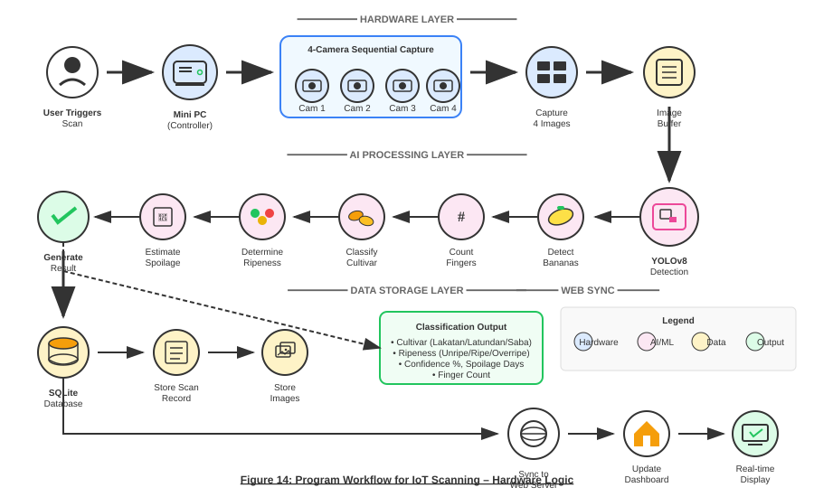

# Program Workflow

A program workflow, sometimes called a process flow or workflow, is the set of actions or stages a system takes to accomplish a particular goal. It displays how activities are arranged from the beginning to the completion of a process. The process of going from an incomplete state to completion, or from raw to processed, is better shown by workflows. They can be used to organize procedures in any company, regardless of sector.

---

## Figure 14: <u>Program Workflow for BananaVision – Operator (Web)</u>

The BananaVision Operator Dashboard uses username and password login and opens a limited-access web dashboard with profile, device status, scan logs, analytics, and inventory areas. The Profile page supports password changes, kiosk PIN updates, avatar uploads, and light/dark theme switching. Device Status shows the 4-camera grid, DHT22 environmental sensor readings (ambient temperature and humidity), and system info. Scan Logs support detail viewing and CSV export, Analytics provides chart-based insights filtered to the logged-in operator's activity, and Inventory provides FIFO recommendations and spoilage alerts based on RFR-estimated days before spoilage. Operators have access to 10 pages total, with all scan data role-filtered to show only their own records.

---

## Figure 15: <u>Program Workflow for BananaVision – Admin (Web)</u>

Administrators log in with their credentials and get access to all operator pages plus six admin-only modules. They can manage users, delivery intakes, supplier management, quality control reviews, all scan records, activity logs, and system settings. The admin tools cover account creation and edits, batch and intake organization, scan corrections, deletion controls, auditing, camera and AI configuration including YOLOv8 confidence threshold adjustments, DHT22 environmental sensor monitoring, mini PC storage management, and power actions, alongside dedicated scan log features that allow administrators to view in-depth scan details including RFR-predicted spoilage days and DHT22 environmental readings, manually update inventory statuses, flag scans for quality review, add review notes, and export records to CSV files. Administrators have full access to all 16 pages in the system.

---

## Figure 16: <u>Program Workflow for BananaVision – IoT</u>

The BananaVision IoT workflow starts when a kiosk scan is triggered. The Mini PC coordinates the 4-camera capture sequence and simultaneously triggers a DHT22 temperature and humidity reading via the Arduino microcontroller, stores the captured frames in a buffer alongside the timestamped environmental log, and passes the image frames through YOLOv8 for detection, counting, cultivar classification, and ripeness stage determination. The YOLOv8 output labels (cultivar type, ripeness stage, and detection confidence) are then concatenated with the concurrent DHT22 readings (temperature and humidity) to form the feature vector input for the Random Forest Regression (RFR) model, which calculates the precise estimated days remaining before spoilage for the scanned batch. This edge setup keeps processing close to the hardware so scans can be completed quickly and consistently, even in a production environment with repeated scans. Results comprising the YOLOv8 classification data, DHT22 environmental log, RFR-predicted spoilage days, and captured image references are stored in the non-cloud PostgreSQL 17+ database hosted on the Mini PC. The system transmits this data to the web dashboard in real-time via an active internet connection, enabling operators to view scan results, multi-angle images, environmental context, and spoilage predictions immediately after each scan.

---

## Figure 17: <u>Program Workflow for BananaVision – Kiosk</u>

Figure 17 shows the BananaVision Kiosk flow: the operator enters a 4-digit PIN, accesses the kiosk terminal, selects a supplier, and opens the full-screen scan interface with recent scans visible. Operator swapping is done inside the same screen through Select Operator and PIN re-entry; if required, a new kiosk PIN is created before returning to scanning. The scan then runs through four AI stages: **Capturing** (4 Cameras + DHT22 Environmental Reading), **Detecting** (YOLOv8 Cultivar and Ripeness Classification), **Analyzing** (Feature Vector Assembly: YOLOv8 outputs + DHT22 readings), and **Calculating** (RFR Predicted Days to Spoil), before the final action of **Accepting** (Confirming) or **Flagging for Review**. Kiosk mode stays focused on scanning only, with no access to logs, analytics, inventory, device status, or admin features.

---

## Workflow Summary

| Figure | User Role | Access Level | Key Features |
|--------|-----------|--------------|--------------|
| 14 | Operator | Web (10 pages) | Profile, logs (own scans), analytics, inventory, device status |
| 15 | Admin | Web (16 pages) | All operator features + user mgmt, intakes, QC, suppliers, activity log, system config |
| 16 | System | IoT Edge | 4-camera + DHT22 → YOLOv8 → RFR → PostgreSQL → Dashboard |
| 17 | Operator | Kiosk Only | PIN auth, supplier selection, 4-stage AI pipeline, accept/flag |

## AI Pipeline Components

### Hardware Layer
- **4-Camera Array**: Multi-angle image capture (Top, Side, Side, Bottom)
- **DHT22 Sensor**: Environmental monitoring (temperature and humidity)
- **Arduino Microcontroller**: DHT22 data acquisition and transmission
- **Mini PC Edge Node**: Local processing and database hosting

### AI/ML Models
- **YOLOv8**: Object detection, cultivar classification, ripeness determination
- **Random Forest Regression (RFR)**: Spoilage prediction based on visual + environmental features

### Data Flow
1. **Capture**: 4 cameras + DHT22 reading (synchronized)
2. **Detection**: YOLOv8 processes images → cultivar, ripeness, confidence
3. **Feature Assembly**: YOLOv8 outputs + DHT22 readings → feature vector
4. **Prediction**: RFR model → estimated days to spoilage
5. **Storage**: PostgreSQL 17+ (local, non-cloud)
6. **Sync**: Real-time transmission to web dashboard

## Database Architecture

- **Database**: PostgreSQL 17+
- **Hosting**: Mini PC (local, non-cloud deployment)
- **Storage**: Scan results, images, environmental logs, predictions
- **Access**: Web dashboard via active internet connection

---

_Document generated for: BananaVision Capstone Project_  
_Bachelor of Science in Information Technology_  
_Cebu Technological University_
