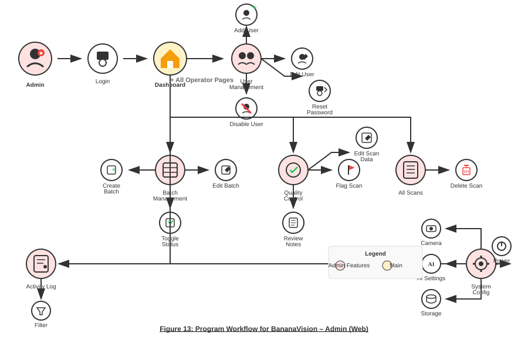

# BananaVision Program Workflows

BananaVision is a browser-based banana inventory and quality-control system using React/Vite frontend, FastAPI backend, REST endpoints under `/api/v1`, and WebSocket events for real-time updates.

## Kiosk Workflow

The BananaVision Kiosk is a full-screen scan interface for banana quality assessment. Operators authenticate with a 4-digit PIN, create or select a delivery intake by supplier, batch, and ripening treatment, then start a scan. The backend captures camera frames and DHT22 sensor data, runs YOLO26 detection, fuses multi-camera results, calculates environmental features, and uses Random Forest Regression to predict spoilage days. The result includes classification data, images, inventory updates, QR metadata, and audit records.

After the result is saved, the system generates and prints a spoilage estimation report through the connected printer. Operators review the result, flag it for quality control when necessary, or continue to the next scan. The kiosk also displays the five most recent scans and supports operator swapping through PIN re-authentication.

## Operator Dashboard

The BananaVision Operator Dashboard is a secure, role-based web system with 10 pages: Dashboard (metrics, recent scans, notifications), Scan Logs (filtering, CSV export, QR actions), Scan Detail (camera evidence, QR tracking, flags, notes, AI values), Analytics (charts, confidence trends, cultivar summaries), Inventory (FIFO, spoilage alerts), Device Status (camera health, DHT22 readings), and Profile (account settings, kiosk PIN, avatar, theme).

## Administrator Dashboard

The BananaVision Administrator Dashboard provides system-wide access through the shared operator dashboard plus six exclusive modules: User Management (account creation, role changes, password resets), Delivery Intakes (intake records, supplier info, scan counts), Supplier Management (add/edit/activate suppliers), Quality Control (review flagged scans, override classifications), Activity Log (audit trail), and System Config (camera configuration, thresholds, data retention, database export, system controls).

## IoT and AI Pipeline

The BananaVision edge hardware and AI pipeline coordinates the Mini PC, multi-camera array, and Arduino DHT22 sensor. When the kiosk triggers a scan via REST API, the Mini PC activates the camera system to capture frames from all configured cameras and retrieves temperature and humidity sensor data from the Arduino via serial connection.

The AI detection stage runs YOLO26 inference on each camera image to extract cultivar, ripeness, confidence score, finger count, and bounding-box evidence per image. Confidence-weighted multi-camera fusion then combines cultivar and ripeness predictions across cameras while using the maximum finger count to avoid double counting. Low confidence or cross-camera disagreement automatically flags the scan for manual review.

The feature engineering stage calculates environmental metrics—dew point, VPD (vapor pressure deficit), and heat index—from the DHT22 sensor data. The spoilage prediction stage uses a Random Forest Regression model trained on visual classification, environmental features, and intake ripening treatment to estimate spoilage days. Results persist with classification, detections, images, inventory status updates, activity logs, and notifications, then broadcast to kiosk and dashboard via WebSocket for real-time user feedback.

## Tech Stack

- **Frontend:** React, Vite, TypeScript
- **Backend:** FastAPI, PostgreSQL
- **Hardware:** OpenCV (multi-camera), Arduino (DHT22 sensor), Mini PC
- **AI:** YOLO26 detection, multi-camera fusion, Random Forest Regression (spoilage prediction)

---

_BananaVision Capstone Project | Cebu Technological University_
