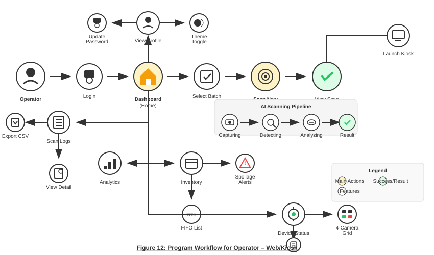

# BananaVision Program Workflows

BananaVision is a browser-based banana inventory and quality-control system. The workflow diagrams describe four connected perspectives: the kiosk scan experience, the operator dashboard, the administrator dashboard, and the edge hardware and AI pipeline. The diagrams are implemented in the Drawio files `workflow_kiosk.drawio`, `workflow_operator.drawio`, `workflow_admin.drawio`, and `workflow_iot.drawio`. The application uses a React/Vite frontend, a FastAPI backend, REST endpoints under `/api/v1`, and WebSocket events under `/api/v1/ws`.

---

## Figure 12A: Kiosk Workflow

The kiosk workflow begins with selecting an active operator and authenticating with a four-digit PIN. New or reset operator accounts must create a new kiosk PIN before continuing. The operator then selects or creates an active delivery intake by choosing a supplier, generating a batch number, and selecting the ripening treatment: Natural or Ethephon.

The full-screen kiosk interface triggers a scan through the backend REST API and receives progress through WebSocket events. The scan captures frames from the configured cameras with available sensor context, runs YOLOv8n detection for each camera image, fuses the multi-camera results, calculates engineered environmental features, and predicts spoilage using the Random Forest Regression model, classification data, sensor values, and intake treatment. The completed result is persisted with classification data, original AI output, camera detections, captured images, inventory status, activity history, notifications, and QR-related metadata. The operator can continue to the next scan or flag the result for quality review. The kiosk also shows recent scans and supports operator swapping through PIN re-authentication.

---

## Figure 12B: Operator Workflow

Operators authenticate with username and password and enter a role-limited dashboard. The dashboard provides operator-filtered metrics, recent scans, active sources, camera health, and notifications. Scan Logs provide filtering, detail navigation, CSV export, QR actions, IoT readings, and inventory status. Scan Detail provides camera evidence, QR tracking, flags, notes, original AI values, and review information. Analytics provides operator-filtered charts, confidence trends, ripeness and cultivar summaries, and source analysis. Inventory provides FIFO recommendations, inventory status summaries, cultivar and ripeness grouping, and spoilage alerts for items estimated to spoil within two days. Device Status provides camera availability, DHT22 readings, API/model/sensor health, system metrics, storage, processor, and uptime information. Profile provides password changes, kiosk PIN changes, avatar upload and removal, theme switching, and personal activity, while the kiosk entry supports intake creation and scan initiation. Operators do not have access to administrator-only routes. Scan records and analytics are filtered to the signed-in operator where the page implements operator-specific views.

---

## Figure 13: Administrator Workflow

Administrators authenticate with username and password and receive the shared dashboard surface plus six administrator-only modules. User Management supports account creation and updates, role and status changes, password resets, and operator PIN resets. Delivery Intakes provides intake records, supplier and treatment information, scan counts, and inventory transitions. Supplier Management supports adding, editing, activating, and deactivating suppliers. Quality Control lists flagged scans, provides evidence and note review, and supports administrator scan overrides. Activity Log supports inspection and filtering of audit activity, while System Config supports camera ID configuration, confidence thresholds, data retention, database export, restart, and shutdown actions. Administrators can view system-wide scan information, including operator, source, intake, IoT readings, spoilage prediction, flags, notes, QR data, and inventory status. Notifications cover scan completion, flagged scans, intake updates, quality warnings, and system alerts.

---

## Figure 14: IoT and AI Workflow

The edge workflow starts when the kiosk requests a scan. The Mini PC keeps the configured camera devices available, captures frames, saves them under the capture directory, and coordinates the AI pipeline. The Arduino communicates DHT22 temperature and humidity readings over the configured serial connection. Sensor readings are periodically persisted and broadcast to the kiosk and dashboard.

The AI path consists of image capture and buffering, followed by YOLOv8n per-camera detection of cultivar, ripeness, confidence, finger count, and bounding-box evidence. Confidence-weighted multi-camera fusion then combines cultivar and ripeness across cameras, while the maximum camera finger count is used to avoid double counting. Conflicts and low confidence can automatically flag the scan. When temperature and humidity are available, the system calculates dew point, VPD, and heat index before the RFR model predicts spoilage using visual classification, environmental features, and linked intake treatment. The final stage persists the result and delivers live updates.

Persisted output includes the scan, classification, original AI result, per-camera detections, image records, inventory status history, activity log, and notifications. Captured images are served from backend capture storage, while result and status updates are delivered to React clients through REST and WebSocket channels.

---

## Workflow Summary

Figure 12A presents the kiosk flow from operator PIN authentication through delivery-intake selection, REST scan triggering, WebSocket progress, and result flagging. Figure 12B presents the operator web flow from login to the role-limited dashboard, scans, analytics, inventory, device status, profile, and kiosk access. Figure 13 presents the administrator web flow from login to the shared dashboard, six administrator modules, and system controls. Figure 14 presents the IoT and AI flow from the cameras and Arduino/DHT22 sensor through YOLOv8n, multi-camera fusion, feature engineering, RFR prediction, persistence, and live dashboard updates.

## AI and Hardware Components

### Hardware and Runtime

The hardware and runtime layer consists of a configured multi-camera array managed by OpenCV, an Arduino serial connection with a DHT22 temperature and humidity sensor, and a Mini PC or local backend runtime for capture, inference, persistence, and storage. Application data is stored in a PostgreSQL-compatible database, while captured images are served from local storage mounted by the FastAPI application.

### AI and Feature Processing

The AI and feature-processing layer uses YOLOv8n for per-image banana detection and classification, confidence-weighted fusion for multi-camera cultivar and ripeness results, and the maximum per-camera finger count to avoid cross-camera double counting. It also calculates dew point, VPD, and heat index, uses Random Forest Regression to estimate spoilage days, and automatically flags scans with low confidence or cross-camera disagreement.

### Data and Event Flow

The operator authenticates and associates the scan with an active intake, after which the kiosk triggers `POST /api/v1/scans/trigger` with the intake context. The backend broadcasts capture, detection, analysis, completion, or failure events, persists the scan result and related evidence, and allows the frontend to receive live progress and update the dashboard, kiosk, device, and notification views.

## Implementation References

The workflow documentation is based on the frontend routing and role guards in `frontend/src/App.tsx`, the kiosk and intake flow in `frontend/src/pages/Kiosk.tsx`, scan state and WebSocket handling in `frontend/src/context/ScanContext.tsx`, intake and supplier state in `frontend/src/context/InventoryContext.tsx`, device and system configuration state in `frontend/src/context/AdminContext.tsx`, scan orchestration in `backend/app/services/scan_service.py`, camera capture in `backend/app/services/camera_manager.py`, classification in `backend/app/services/classification.py`, multi-camera fusion in `backend/app/services/fusion_engine.py`, sensor polling in `backend/app/services/sensor_reader.py`, API registration in `backend/app/api/v1/router.py`, application and WebSocket setup in `backend/app/main.py`, and the project-wide context in `docs/BANANAVISION_CONTEXT.md`.

---

_BananaVision Capstone Project_

_Bachelor of Science in Information Technology_

_Cebu Technological University_
