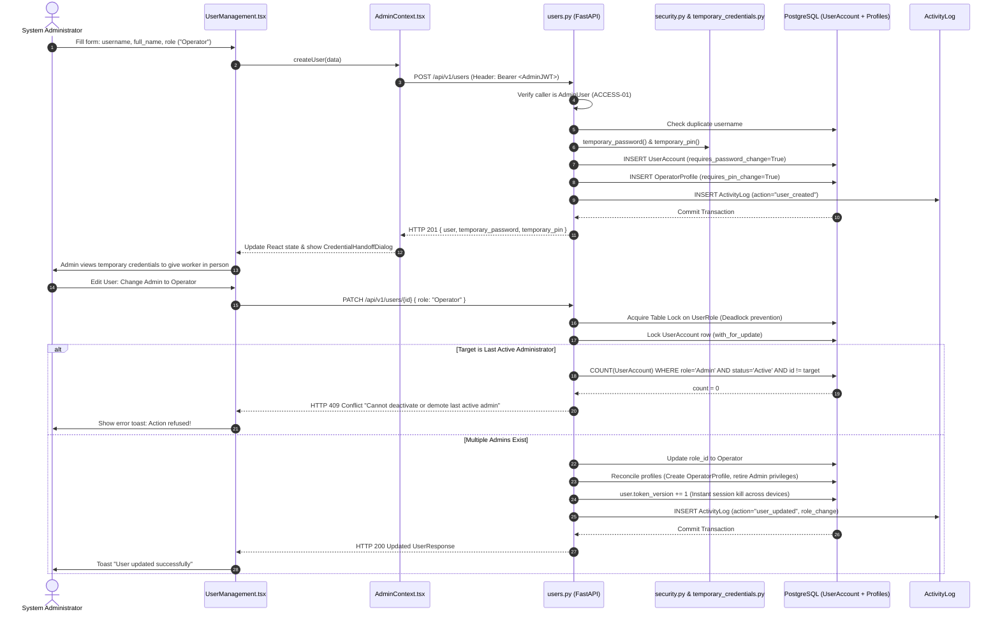

# 👥 Master Guide: User Management, Account Governance & Role Reconciliation

> **Presenter & Author:** Kent RG A. Baguio  
> **Core Focus:** User Provisioning Lifecycle, Profile Polymorphism (`AdminProfile` vs `OperatorProfile`), Concurrency Deadlock Prevention, The Last Active Admin Safeguard (`ADMIN-01`), Role Transitions (`ROLE-01`), and Dedicated Credential Resets.  
> **Backend Files:**
> - [`backend/app/api/v1/users.py`](file:///d:/KENT%20EDUCATION%20PROJECTS/BananaVision/backend/app/api/v1/users.py) — Admin route controllers for listing, creating, patching, and resetting users
> - [`backend/app/models/user_account.py`](file:///d:/KENT%20EDUCATION%20PROJECTS/BananaVision/backend/app/models/user_account.py) — Core user entity with `token_version` and status
> - [`backend/app/models/admin_profile.py`](file:///d:/KENT%20EDUCATION%20PROJECTS/BananaVision/backend/app/models/admin_profile.py) — Administrator metadata table
> - [`backend/app/models/operator_profile.py`](file:///d:/KENT%20EDUCATION%20PROJECTS/BananaVision/backend/app/models/operator_profile.py) — Kiosk operator metadata, `pin_hash`, and PIN change flags
> - [`backend/app/core/temporary_credentials.py`](file:///d:/KENT%20EDUCATION%20PROJECTS/BananaVision/backend/app/core/temporary_credentials.py) — High-entropy random temporary credential generation
>
> **Frontend Files:**
> - [`frontend/src/pages/admin/UserManagement.tsx`](file:///d:/KENT%20EDUCATION%20PROJECTS/BananaVision/frontend/src/pages/admin/UserManagement.tsx) — User table, search/filter memoization, create modal, reset dialogs, handoff card
> - [`frontend/src/context/AdminContext.tsx`](file:///d:/KENT%20EDUCATION%20PROJECTS/BananaVision/frontend/src/context/AdminContext.tsx) — Admin state management and optimistic cache updates

---

## 1. Why Did We Implement This System? (Panel Defense Rationale)

### 1.1 The Operational Need: Strict Industrial Privilege Separation
In an industrial packinghouse sorting banana hands, two distinct classes of workers interact with BananaVision:
1. **Quality Sorting Operators:** Need access only to Kiosk mode, camera views, and scan intake logging. They must never access system reboot controls, hardware camera index remapping, or raw database backups.
2. **Plant Supervisors & System Administrators:** Configure camera calibration, set quality thresholds, manage employee rosters, inspect audit logs, and export reports.

### 1.2 Why No "Delete User" Button? (Audit Integrity vs Data Loss)
In standard web apps, developers often add a red "Delete Account" button. In BananaVision, **hard deletes are strictly forbidden**:
- **Foreign Key Integrity:** Every historical banana scan in PostgreSQL (`scans` table) holds an `operator_id` pointing to an `OperatorProfile`. Deleting an operator would either:
  1. Cascade-delete thousands of historical scan records (destroying commercial inventory records).
  2. Cause database constraint violations (`ForeignKeyViolationError`).
  3. Set `operator_id = NULL`, destroying worker accountability for spoiled or misclassified fruit.
- **The Solution — Soft Deactivation:** We provide an **Active / Inactive** toggle (`ActiveStatusEnum`). When an employee leaves the company, an Admin toggles their status to `Inactive`.  
  This updates PostgreSQL, immediately increments `token_version += 1` (ejecting any active sessions), and prevents login—while preserving 100% of historical scans, audit logs, and analytics.

### 1.3 Why Split `UserAccount`, `AdminProfile`, and `OperatorProfile`?
Instead of stuffing 25 nullable columns into a single monolithic `users` table:
- **`user_accounts`:** Holds universal identity attributes: `id` (UUID), `username`, `full_name`, `password_hash`, `status`, `token_version`, and `role_id`.
- **`admin_profiles`:** Holds admin-specific attributes (e.g. `department`).
- **`operator_profiles`:** Holds kiosk-specific credentials (`pin_hash`, `requires_pin_change`, `pin_setup_reason`) and serves as the foreign key target for `scans.operator_id`.
- **Promotion / Demotion Safety:** When an operator is promoted to Admin, their `OperatorProfile` is retained so past scan ownership is preserved, but their `pin_hash` is wiped so they cannot bypass password authentication.

---

## 2. High-Level Architecture & End-to-End Sequence Diagram



---

## 3. Step-by-Step Code Walkthrough: Front to Back to Front

Let us trace every line of code executed during account provisioning, role updates, and credential resets.

### Step 1: Account Creation in [`frontend/src/pages/admin/UserManagement.tsx`](file:///d:/KENT%20EDUCATION%20PROJECTS/BananaVision/frontend/src/pages/admin/UserManagement.tsx)

When the administrator opens the "Create User" dialog, fills out the form, and clicks **Create Account**:

```tsx
// frontend/src/pages/admin/UserManagement.tsx (lines 140-185)
const handleCreateUser = async (e: React.FormEvent) => {
  e.preventDefault()
  try {
    setSubmitting(true)
    // 1. Call AdminContext which performs the network request
    const created = await createUser({
      username: formData.username,
      full_name: formData.fullName,
      role: formData.role,
      status: formData.status,
    })
    
    // 2. Open Credential Handoff Dialog displaying generated temporary credentials
    setHandoffCredentials({
      username: created.username,
      temporaryPassword: created.temporary_password,
      temporaryPin: created.temporary_pin,
    })
    setIsCreateOpen(false)
    setShowHandoffModal(true)
    toast.success("Account created successfully")
  } catch (err) {
    // SAVE-01 Fix: On backend error, keep modal open, do not fabricate local state
    toast.error("Failed to create user", { description: err.message })
  } finally {
    setSubmitting(false)
  }
}
```

- **SAVE-01 Vulnerability Fix:** In earlier iterations, a frontend try/catch caught errors and pushed a simulated user into local React state. We eliminated that. The UI waits for a real HTTP 201 response containing the database-generated UUID and credentials before updating the view.

---

### Step 2: Backend Ingress & Validation in [`backend/app/api/v1/users.py:62`](file:///d:/KENT%20EDUCATION%20PROJECTS/BananaVision/backend/app/api/v1/users.py)

FastAPI receives `POST /api/v1/users`:

```python
# backend/app/api/v1/users.py (lines 62-113)
@router.post("", response_model=UserCreatedResponse, status_code=201)
async def create_user(
    body: UserCreate, 
    db: DbSession, 
    admin: AdminUser,               # ACCESS-01: Admin authorization dependency
    request: Request, 
    response: Response
):
    # 1. Disable browser caching of credential responses
    response.headers["Cache-Control"] = "no-store"
    
    # 2. Duplicate Username Check
    existing = await db.execute(select(UserAccount).where(UserAccount.username == body.username))
    if existing.scalar_one_or_none():
        raise ConflictException(f"Username '{body.username}' already exists")

    # 3. Dynamic High-Entropy Temporary Credentials (CREATE-02)
    password = body.password or temporary_password()
    pin = (body.pin or temporary_pin()) if body.role == RoleEnum.OPERATOR else None

    # 4. Instantiate UserAccount with Forced First-Time Setup
    user = UserAccount(
        username=body.username,
        full_name=body.full_name,
        password_hash=hash_password(password),
        role_id=user_role.id,
        status=body.status,
        requires_password_change=True,
        password_setup_reason=PasswordSetupReasonEnum.NEW_ACCOUNT,
    )

    # 5. Attach Profile Table
    if body.role == RoleEnum.ADMIN.value:
        user.admin_profile = AdminProfile()
    elif body.role == RoleEnum.OPERATOR.value:
        user.operator_profile = OperatorProfile(
            pin_hash=hash_pin(pin),
            requires_pin_change=True,
            pin_setup_reason=PinSetupReasonEnum.NEW_ACCOUNT,
        )

    db.add(user)
    
    # 6. Forensic Audit Log
    db.add(ActivityLog(
        user_id=admin.id,
        action="user_created",
        details=f"Created user '{body.username}' with role {body.role.value}",
        ip_address=get_client_ip(request),
    ))
    await db.flush()

    return UserCreatedResponse(
        **UserResponse.from_db_model(user).model_dump(),
        temporary_password=password,
        temporary_pin=pin,
    )
```

- **Why `Cache-Control: no-store`?** The response payload carries the generated plaintext temporary credentials. Setting `no-store` instructs reverse proxies and browser caches never to write these credentials to disk.

---

### Step 3: The Last Active Administrator Safeguard (`ADMIN-01`) (`users.py:198`)

What happens if an admin attempts to deactivate or demote the only remaining admin in the facility?

```python
# backend/app/api/v1/users.py (lines 198-225)
is_currently_active_admin = (
    user.role and user.role.name == RoleEnum.ADMIN.value
    and user.status == ActiveStatusEnum.ACTIVE
)

if is_currently_active_admin:
    demoting = body.role is not None and body.role != RoleEnum.ADMIN
    deactivating = body.status is not None and body.status != ActiveStatusEnum.ACTIVE
    
    if demoting or deactivating:
        # Count all other active administrators in PostgreSQL
        active_admin_count_result = await db.execute(
            select(func.count())
            .select_from(UserAccount)
            .join(UserRole, UserAccount.role_id == UserRole.id)
            .where(
                UserRole.name == RoleEnum.ADMIN.value,
                UserAccount.status == ActiveStatusEnum.ACTIVE,
                UserAccount.id != user_id,  # Exclude the target account being edited!
            )
        )
        other_active_admins = active_admin_count_result.scalar() or 0
        
        if other_active_admins == 0:
            raise ConflictException(
                "Cannot deactivate or demote the last active administrator. "
                "Promote or activate another admin first."
            )
```

#### Deadlock Prevention Mechanics:
Notice lines 175-176 in `users.py`:
```python
await db.execute(update(UserRole).where(UserRole.name == RoleEnum.ADMIN.value).values(name=UserRole.name))
```
- **Why this exists:** If two administrators attempt to edit each other's roles simultaneously, two separate PostgreSQL transactions could acquire conflicting row-level locks on `user_accounts`, resulting in a database deadlock. By executing a dummy touch on `UserRole` first, transactions are serialized cleanly at the table level before acquiring row locks with `with_for_update()`.

---

### Step 4: Role Transitions & Profile Reconciliation (`ROLE-01`) (`users.py:250`)

When a user's role is changed in `PATCH /api/v1/users/{id}`:

```python
# backend/app/api/v1/users.py (lines 250-275)
if new_role_name and new_role_name != old_role_name:
    if new_role_name == RoleEnum.ADMIN.value:
        # Case 1: Operator PROMOTED to Admin
        if not user.admin_profile:
            user.admin_profile = AdminProfile()
        # Retire Kiosk PIN so the old 4-digit PIN cannot bypass password login
        if user.operator_profile:
            user.operator_profile.pin_hash = None
            user.operator_profile.requires_pin_change = False
            user.operator_profile.pin_setup_reason = None
            
    elif new_role_name == RoleEnum.OPERATOR.value:
        # Case 2: Admin DEMOTED to Operator
        if not user.operator_profile:
            user.operator_profile = OperatorProfile()
        user.operator_profile.pin_hash = None
        user.operator_profile.requires_pin_change = True
        user.operator_profile.pin_setup_reason = PinSetupReasonEnum.NEW_ACCOUNT

    # Revoke all currently active JWT sessions across all devices!
    user.token_version += 1
```

- **Crucial Defense Detail:** Notice that when an Operator is promoted to Admin, we do **not** delete their `OperatorProfile` row! We keep the row so foreign keys on historical scans remain intact, but we set `pin_hash = None`. This prevents an attacker from using the old 4-digit PIN at the kiosk to authenticate as an Admin.

---

### Step 5: Dedicated Password & PIN Resets (`RESET-01`) (`users.py:291` & `321`)

When an operator forgets their PIN or an admin forgets their password, the Admin clicks "Reset Password" or "Reset PIN" in `UserManagement.tsx`:

```python
# backend/app/api/v1/users.py (lines 291-319)
@router.post("/{user_id}/reset-password")
async def reset_user_password(user_id: uuid.UUID, body: UserPasswordReset, db: DbSession, admin: AdminUser, request: Request, response: Response):
    response.headers["Cache-Control"] = "no-store"
    user = (await db.execute(select(UserAccount).where(UserAccount.id == user_id).with_for_update())).scalar_one_or_none()
    if not user: raise NotFoundException("User")

    password = body.new_password or temporary_password()
    user.password_hash = hash_password(password)
    user.requires_password_change = True
    user.password_setup_reason = body.password_setup_reason or PasswordSetupReasonEnum.PASSWORD_RESET
    
    # ── Instant Session Revocation (AUTH-02) ──────────────────────────
    user.token_version += 1

    db.add(ActivityLog(
        user_id=admin.id,
        action="user_updated",
        details=f"Admin reset password for user '{user.username}'",
        ip_address=get_client_ip(request),
    ))
    await db.flush()
    return {"message": "Password reset successfully", "temporary_password": password}
```
And for PIN resets:
```python
# backend/app/api/v1/users.py (lines 321-354)
@router.post("/{user_id}/reset-pin")
async def reset_user_pin(user_id: uuid.UUID, body: UserPinReset, db: DbSession, admin: AdminUser, request: Request, response: Response):
    response.headers["Cache-Control"] = "no-store"
    user = (await db.execute(select(UserAccount).options(selectinload(UserAccount.operator_profile), selectinload(UserAccount.role)).where(UserAccount.id == user_id).with_for_update())).scalar_one_or_none()
    
    if user.role.name != RoleEnum.OPERATOR.value:
        raise ForbiddenException("PIN credentials are only available to operators")

    pin = body.new_pin or temporary_pin()
    user.operator_profile.pin_hash = hash_pin(pin)
    user.operator_profile.requires_pin_change = True
    user.operator_profile.pin_setup_reason = body.pin_setup_reason or PinSetupReasonEnum.PIN_RESET
    user.token_version += 1
    ...
    return {"message": "PIN reset successfully", "temporary_pin": pin}
```

---

## 4. Security Vulnerabilities Fixed in This Module

| Vulnerability ID | Historical Flaw Identified | How Kent's Code Fixed It |
|---|---|---|
| **SAVE-01** | UI caught API errors and fabricated local fake users in React state, making failed operations appear successful. | Fixed in `UserManagement.tsx` and `AdminContext.tsx`: React awaits real database response; on failure, preserves inputs and displays exact error message. |
| **CREATE-01** | Account creation modal allowed choosing "Inactive", but the backend ignored the field and hardcoded status to `Active`. | `body.status` is now passed directly into SQLAlchemy model initialization. |
| **CREATE-02** | Hardcoded initial credentials were logged in plaintext to stdout terminal. | Replaced with cryptographically random `temporary_password()` and `temporary_pin()` generators, returned with `Cache-Control: no-store`. |
| **ACCESS-01** | Listing and managing users used generic `CurrentUser`, allowing regular operators to fetch administrative rosters. | Protected with `admin: AdminUser` dependency in `deps.py`. |
| **ROLE-01** | Role changes left stale credentials (e.g. promoted Admin could still log in with an old 4-digit PIN). | Automatic Profile Reconciliation: demoting an Admin creates `OperatorProfile` with forced PIN change; promoting an Operator creates `AdminProfile` and sets `pin_hash = None`. |
| **ADMIN-01** | The sole administrator could demote or deactivate themselves, permanently bricking system administration. | Last Active Admin Safeguard: counts other active admins with `select(func.count())` under lock; aborts with HTTP 409 Conflict if count is 0. |
| **RESET-01** | UI invoked generic `PATCH /users/{id}` (which ignored password fields) instead of dedicated reset routes. | Routed to dedicated `POST /users/{id}/reset-password` and `POST /users/{id}/reset-pin` endpoints with audit logging. |

---

## 5. Defense Cheat Sheet: Panel Traps & Winning Answers

### Question 1: "Why don't you have a 'Delete User' button in User Management?"
> **Kent's Winning Answer:**  
> "In an automated agricultural sorting station, every scan record and audit entry in PostgreSQL links to a user ID. If an operator were deleted, their historical scans would either cascade-delete (destroying compliance and batch intake history) or violate database foreign key constraints. Instead, we implement soft deactivation (`ActiveStatusEnum.INACTIVE`). Deactivating an account immediately increments `token_version` by 1 to kill active sessions and blocks future logins, while preserving 100% of historical traceability."

### Question 2: "What stops a disgruntled administrator from deactivating all other admins and locking the entire system?"
> **Kent's Winning Answer:**  
> "We engineered the **ADMIN-01 Last Active Admin Safeguard** in `backend/app/api/v1/users.py:198`. Before allowing any PATCH request that demotes or deactivates an administrator, PostgreSQL executes a serialized transaction lock and counts all other active administrators. If that count is zero, the transaction is rejected with an `HTTP 409 Conflict` error stating: *'Cannot deactivate or demote the last active administrator'*. An admin can never lock the system out."

### Question 3: "Why do you generate temporary credentials in the backend and return them in the API response?"
> **Kent's Winning Answer:**  
> "BananaVision operates offline on a Mini PC with no internet and no email server, so an automated email link cannot be sent. The administrator must see the generated temporary password or PIN once to hand it to the physical worker in person via our `CredentialHandoffDialog`. We protect this by setting `Cache-Control: no-store` on the HTTP response, and marking `requires_password_change = True`. That temporary credential cannot access the dashboard; it only issues a 10-minute setup token that forces the worker to establish their private password."

### Question 4: "What happens to past scan history when an Operator is promoted to an Administrator?"
> **Kent's Winning Answer:**  
> "This is governed by our **ROLE-01 Profile Reconciliation** logic in `users.py:250`. When promoted, we instantiate their `AdminProfile`, but we intentionally preserve their existing `OperatorProfile` row so that all historical scans linked to `operator_id` remain intact. However, we wipe `pin_hash = None` and increment `token_version += 1`. This prevents the user from using an old 4-digit PIN to authenticate as an Administrator, forcing them to authenticate exclusively via username and password."
