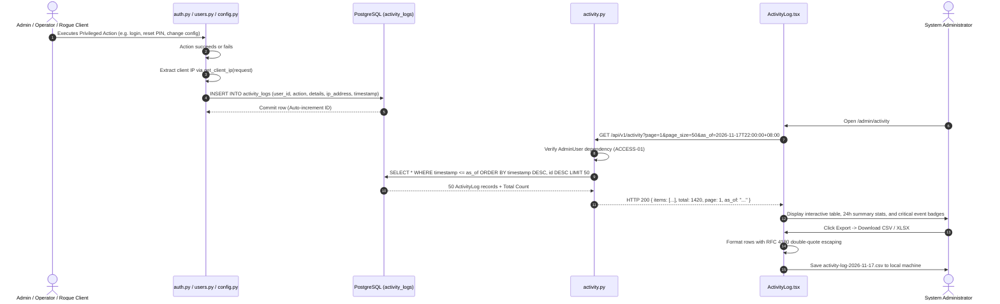

# 📜 Master Guide: Activity Logs, Forensics & Audit Trail Architecture

> **Presenter & Author:** Kent RG A. Baguio  
> **Core Focus:** Immutable Forensic Auditing, Server-Side Pagination with `as_of` Snapshot Pinning (`AUDIT-01`), Security Failure Tracing (`AUDIT-02`), and RFC-Compliant Multi-Format Export (`AUDIT-03`).  
> **Backend Files:**
> - [`backend/app/api/v1/activity.py`](file:///d:/KENT%20EDUCATION%20PROJECTS/BananaVision/backend/app/api/v1/activity.py) — Admin endpoint for paginated and filtered activity retrieval
> - [`backend/app/models/activity_log.py`](file:///d:/KENT%20EDUCATION%20PROJECTS/BananaVision/backend/app/models/activity_log.py) — PostgreSQL audit table model
> - [`backend/app/core/http.py`](file:///d:/KENT%20EDUCATION%20PROJECTS/BananaVision/backend/app/core/http.py) — Client IP address resolution helper
>
> **Frontend Files:**
> - [`frontend/src/pages/admin/ActivityLog.tsx`](file:///d:/KENT%20EDUCATION%20PROJECTS/BananaVision/frontend/src/pages/admin/ActivityLog.tsx) — Activity table, action badges, stats cards, CSV and XLSX export
> - [`frontend/src/context/AdminContext.tsx`](file:///d:/KENT%20EDUCATION%20PROJECTS/BananaVision/frontend/src/context/AdminContext.tsx) — Administrative log state synchronization
> - [`frontend/src/lib/exportUtils.ts`](file:///d:/KENT%20EDUCATION%20PROJECTS/BananaVision/frontend/src/lib/exportUtils.ts) — RFC 4180 quote-escaping CSV & Excel workbook generators

---

## 1. Why Did We Implement This System? (Panel Defense Rationale)

### 1.1 The Operational Need: Non-Repudiation in Agricultural Quality Control
In commercial banana distribution (exporting Cavendish, Lakatan, or Cardaba to international markets or retail chains):
- If an entire container of bananas arrives at a shipping dock overripe or spoiled, an investigation occurs.
- Management needs to know: *Who calibrated Camera 1? Who changed the AI ripeness threshold from 85% to 60%? Which operator scanned Batch #409?*
- Without an immutable forensic log, operators and supervisors can point fingers at each other. BananaVision's audit architecture guarantees **non-repudiation**: every state mutation is stamped with the actor's UUID, their client IP address, and an exact Asia/Manila timestamp.

### 1.2 Forensic Visibility on Brute-Force Attacks (AUDIT-02)
If a rogue user connects to the packinghouse Wi-Fi and tries to guess a 4-digit operator PIN or brute-force an Admin password:
- The system must not merely block them; it must generate a permanent forensic trail.
- When `login_failed` or `pin_failed` triggers in `backend/app/api/v1/auth.py`, `user_id` is set to `None`, but the target username and the attacker's client IP address (`get_client_ip(request)`) are permanently written to PostgreSQL. An administrator can review the logs and alert on-site facility security.

### 1.3 Why Strict Admin Authorization (`ACCESS-01`)?
Audit logs contain sensitive operational intelligence: IP addresses of management terminals, records of failed login attacks, and timestamps of employee shift changes.
- Regular kiosk operators are restricted from querying `/api/v1/activity`.
- Protected by `admin: AdminUser` dependency in `deps.py`: attempting to call this route with an Operator JWT returns `HTTP 403 Forbidden: Admin access required`.

---

## 2. High-Level Architecture & End-to-End Sequence Diagram



---

## 3. Step-by-Step Code Walkthrough: Front to Back to Front

### Step 1: Emitting Audit Logs Across the Codebase

Every major service in BananaVision writes to `activity_logs`. For example, in [`backend/app/api/v1/auth.py:97`](file:///d:/KENT%20EDUCATION%20PROJECTS/BananaVision/backend/app/api/v1/auth.py):

```python
# Failed login attempt (Unauthenticated)
db.add(ActivityLog(
    user_id=None,
    action="login_failed",
    details=f"Failed login attempt for username '{body.username}'",
    ip_address=get_client_ip(request),
))
await db.flush()
```
And on successful login (`auth.py:129`):
```python
db.add(ActivityLog(
    user_id=user.id,
    action="login",
    details=f"User {user.username} logged in",
    ip_address=get_client_ip(request),
))
await db.flush()
```
And on configuration modifications (`config.py:161`):
```python
db.add(ActivityLog(
    user_id=admin.id,
    action="config_changed",
    details=f"Updated config revision {config.revision}: {changes}",
    ip_address=get_client_ip(request),
))
```

---

### Step 2: The `ActivityLog` Database Model in [`backend/app/models/activity_log.py`](file:///d:/KENT%20EDUCATION%20PROJECTS/BananaVision/backend/app/models/activity_log.py)

```python
class ActivityLog(Base):
    __tablename__ = "activity_logs"

    id: Mapped[int] = mapped_column(Integer, primary_key=True, autoincrement=True)
    user_id: Mapped[uuid.UUID | None] = mapped_column(ForeignKey("user_accounts.id"), nullable=True)
    action: Mapped[str] = mapped_column(String(50), nullable=False)
    details: Mapped[str | None] = mapped_column(Text, nullable=True)
    ip_address: Mapped[str | None] = mapped_column(String(45), nullable=True)
    timestamp: Mapped[datetime] = mapped_column(DateTime(timezone=True), default=now_manila)

    user: Mapped[UserAccount | None] = relationship("UserAccount", lazy="selectin")
```

- **Database Structure:** Timestamps use `DateTime(timezone=True)` defaulting to `now_manila` (`Asia/Manila` UTC+08:00).
- `ip_address` is sized at `String(45)` to accommodate standard IPv4 (e.g. `192.168.1.100`) as well as full IPv6 addresses (e.g. `2001:0db8:85a3:0000:0000:8a2e:0370:7334`).

---

### Step 3: Server-Side Query & `as_of` Pagination Boundary in [`backend/app/api/v1/activity.py`](file:///d:/KENT%20EDUCATION%20PROJECTS/BananaVision/backend/app/api/v1/activity.py)

When an administrator navigates through pages of logs:

```python
# backend/app/api/v1/activity.py (lines 24-84)
@router.get("", response_model=ActivityLogListResponse)
async def list_activity(
    db: DbSession,
    admin: AdminUser,                 # ACCESS-01: Admin authorization guard
    page: int = Query(1, ge=1),
    page_size: int = Query(50, ge=1, le=200),
    action: str | None = None,
    user_name: str | None = None,
    search: str | None = None,
    as_of: InputTimestamp | None = None,  # AUDIT-01: Snapshot boundary
):
    # ── AUDIT-01: Pin pagination to an as_of snapshot boundary ──────
    boundary = as_of
    if boundary is None:
        boundary = now_manila()
        newest = await db.scalar(select(func.max(ActivityLog.timestamp)))
        if newest is not None and newest > boundary:
            boundary = newest

    query = (
        select(ActivityLog)
        .options(selectinload(ActivityLog.user))
        .where(ActivityLog.timestamp <= boundary) # Prevents new rows from shifting pages!
        .order_by(desc(ActivityLog.timestamp), desc(ActivityLog.id))
    )

    # 1. Filter by specific action (e.g. "login", "pin_failed", "config_changed")
    if action:
        query = query.where(ActivityLog.action == action)

    # 2. Filter by actor name
    if user_name:
        from app.models.user_account import UserAccount
        query = query.join(ActivityLog.user).where(UserAccount.full_name == user_name)

    # 3. Full-text search across action, details, and user name
    if search:
        from app.models.user_account import UserAccount
        search_pattern = f"%{search}%"
        query = query.outerjoin(ActivityLog.user).where(
            or_(
                ActivityLog.action.ilike(search_pattern),
                ActivityLog.details.ilike(search_pattern),
                UserAccount.full_name.ilike(search_pattern),
            )
        )

    # Total matching count for pagination controls
    count_query = select(func.count()).select_from(query.subquery())
    total = (await db.execute(count_query)).scalar() or 0

    # SQL Offset and Limit
    query = query.offset((page - 1) * page_size).limit(page_size)
    result = await db.execute(query)
    logs = result.scalars().all()

    return ActivityLogListResponse(
        items=[...],
        total=total,
        page=page,
        page_size=page_size,
        as_of=boundary, # Return boundary to client so page 2 keeps the same snapshot!
    )
```

#### What is the `as_of` Boundary Problem? (Panel Goldmine)
In high-volume logging systems, if an administrator is reading page 1 (rows 1–50) and 5 new scans occur, those 5 new rows are inserted at the top.  
When the admin clicks "Page 2" (`OFFSET 50`), traditional SQL offset pagination shifts: the admin will see rows 46–50 a second time!  
**Our Fix:** By passing `timestamp <= as_of`, the query evaluates against a frozen snapshot of time. New incoming log rows cannot push older rows into subsequent pages.

---

### Step 4: RFC 4180 Compliant Multi-Format Export in [`frontend/src/pages/admin/ActivityLog.tsx`](file:///d:/KENT%20EDUCATION%20PROJECTS/BananaVision/frontend/src/pages/admin/ActivityLog.tsx)

```tsx
// frontend/src/pages/admin/ActivityLog.tsx (lines 62-85)
const handleExportCsv = () => {
  if (activityLoading || !!activityError || !activityReady) return
  const logs = sortedLogsRef.current
  const filename = `activity-log-${manilaDayKey(Date.now())}.csv`
  const headers = ["Timestamp", "User", "Action", "Details", "IP Address"]
  const rows = logs.map(log => [
    log.timestamp,
    log.user,
    log.action,
    log.details,
    log.ipAddress || ""
  ])
  downloadCsv(filename, headers, rows) // Uses RFC 4180 quotation doubling
  toast.success("Export successful", { description: `${logs.length} activities exported to CSV` })
}

const handleExportXlsx = async () => {
  // Generates real Excel workbook via xlsx library
  await downloadXlsx(filename, headers, rows)
}
```

In `frontend/src/lib/exportUtils.ts`:
```ts
export function escapeCsvCell(val: unknown): string {
  if (val === null || val === undefined) return ""
  const str = String(val)
  // RFC 4180: If string contains quotes, commas, or newlines, wrap in quotes and double internal quotes
  if (/[",\n\r]/.test(str)) {
    return `"${str.replace(/"/g, '""')}"`
  }
  return str
}
```

---

## 4. Security Vulnerabilities Fixed in This Module

| Vulnerability ID | Historical Flaw Identified | How Kent's Code Fixed It |
|---|---|---|
| **ACCESS-01** | The `/activity` endpoint only checked `CurrentUser`, meaning regular kiosk operators could view management audit logs. | Bound endpoint to `admin: AdminUser` dependency, rejecting non-admins with `HTTP 403 Forbidden`. |
| **AUDIT-01** | Logs were paginated in client-side React memory after fetching 50 items; older logs were invisible to search and filters. | Built true server-side pagination with SQL `OFFSET`/`LIMIT`, dynamic filtering (`action`, `user_name`, `search`), and snapshot `as_of` timestamp pinning. |
| **AUDIT-02** | Failed logins, PIN guesses, and admin password resets did not generate audit records. | Instrumenting automatic `ActivityLog` commits across all authentication failures, password/PIN resets, config changes, and hardware operations. |
| **AUDIT-03** | CSV export did not escape internal quotation marks or commas, corrupting rows in Microsoft Excel. | Implemented RFC 4180 standard quotation doubling (`.replace(/"/g, '""')`) and provided dual **CSV and XLSX** export options. |

---

## 5. Defense Cheat Sheet: Panel Traps & Winning Answers

### Question 1: "Why do you record failed login attempts if you don't even know who the user is?"
> **Kent's Winning Answer:**  
> "When an unauthorized user or brute-force bot tries guessing passwords, recording the failure is critical for intrusion detection. In `auth.py`, on failed attempts we set `user_id = None`, but we record the targeted username, the failure reason, and the client's IP address using `get_client_ip(request)`. If an admin notices 50 failed login attempts coming from a specific IP address on the local network, facility management can physically trace the terminal or device attempting unauthorized access."

### Question 2: "What is the `as_of` parameter in your activity endpoint, and why did you add it?"
> **Kent's Winning Answer:**  
> "The `as_of` parameter solves the classic **pagination drift problem** in relational databases. If an administrator is reading Page 1, and 10 new banana scans are processed simultaneously, those 10 new rows get inserted at the top. Without `as_of`, when the admin clicks to Page 2 with `OFFSET 50`, the rows have shifted down by 10, causing the admin to see duplicate records they already read on Page 1. By pinning the query to `ActivityLog.timestamp <= as_of`, the administrator reads against a stable point-in-time snapshot."

### Question 3: "Why can't Kiosk Operators view the Activity Log?"
> **Kent's Winning Answer:**  
> "The Activity Log contains privileged administrative intelligence: IP addresses of management workstations, records of employee PIN resets, role changes, and system shutdowns. Kiosk operators need only quality inspection tools. Exposing security audit logs to non-administrative staff violates the principle of least privilege. We enforce this at the backend routing level using our `AdminUser` FastAPI dependency."
