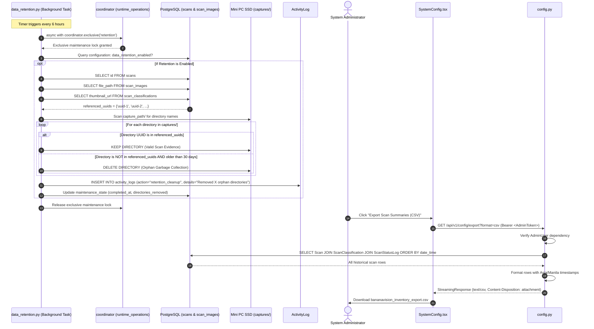

# 💾 Master Guide: Data Retention, Storage Preservation & Scan Export

> **Presenter & Author:** Kent RG A. Baguio  
> **Core Focus:** Automated Disk Preservation, Unreferenced Orphan Capture Cleanup (`data_retention_worker`), Analytical CSV/XLSX Streaming, and Full Station Backup vs Inventory Export (`RETENTION-03`).  
> **Backend Files:**
> - [`backend/app/services/data_retention.py`](file:///d:/KENT%20EDUCATION%20PROJECTS/BananaVision/backend/app/services/data_retention.py) — Background retention worker, orphan directory pruning
> - [`backend/app/api/v1/config.py`](file:///d:/KENT%20EDUCATION%20PROJECTS/BananaVision/backend/app/api/v1/config.py) — Analytical scan export (`/config/export`)
> - [`backend/app/models/system_config.py`](file:///d:/KENT%20EDUCATION%20PROJECTS/BananaVision/backend/app/models/system_config.py) — Retention configuration schema
> - [`backend/app/services/backup_archive.py`](file:///d:/KENT%20EDUCATION%20PROJECTS/BananaVision/backend/app/services/backup_archive.py) — Full station backup and restore archive manager
>
> **Frontend Files:**
> - [`frontend/src/pages/admin/SystemConfig.tsx`](file:///d:/KENT%20EDUCATION%20PROJECTS/BananaVision/frontend/src/pages/admin/SystemConfig.tsx) — Retention toggle switch, export buttons, StationBackupControls modal

---

## 1. Why Did We Implement This System? (Panel Defense Rationale)

### 1.1 The Operational Problem: SSD Exhaustion on an Edge Mini PC
BananaVision is a 4-camera computer vision station capturing high-resolution photos with every scan:
- 4 physical cameras $\times$ ~1.5–2 MB per JPEG image $\approx$ **6 to 8 MB per scan**.
- In a busy commercial packinghouse processing 500 banana hands per day:
  $$500 \text{ scans/day} \times 8 \text{ MB} = 4 \text{ GB of imagery daily} \implies 120 \text{ GB per month!}$$
- BananaVision runs on a compact Mini PC with a 256 GB or 512 GB SSD. If storage is unmanaged, the solid-state drive will fill to 100% capacity in 60 to 90 days.
- When an SSD fills completely, PostgreSQL crashes, file writes fail, and the kiosk operating system becomes unbootable.

### 1.2 The Storage Paradox: What Gets Deleted vs What Gets Kept?
A critical question in commercial compliance is: *Can you delete historical quality inspections?*  
**No!** If a grocery distributor disputes a fruit shipment from three weeks ago, management must be able to pull up the scan record, the operator who inspected it, the AI confidence score, and the thumbnail evidence.
- **The Solution — The Dual Retention Policy:**
  1. **Persisted Scan Records & Evidence are Retained:** Valid scans in PostgreSQL (`scans`, `scan_images`, `scan_classifications`) and their referenced evidence images are **never deleted** by automated retention.
  2. **Unreferenced Orphan Captures are Pruned:** If an operator cancels a scan, if a camera driver drops frames mid-capture, or if a temporary calibration capture was saved without an associated database row, those files are "orphans". The background worker (`remove_expired_orphans`) scans the disk every 6 hours and deletes orphan directories older than 30 days (`max_captures_retention_days`).

### 1.3 Analytical CSV Export vs Full Station Backup (`RETENTION-03`)
In early UI iterations, an export button was mislabeled *"Database Backup"*. This was dangerous: users assumed clicking it created a disaster recovery file.
- **Analytical Export (`/config/export`):** Generates a CSV or XLSX spreadsheet containing scan summaries (Date, Cultivar, Ripeness, Finger Count, Confidence, Inventory Status). It contains no user accounts, no passwords, no camera settings, and no image files. It is strictly an operational report for Excel and Google Sheets.
- **True Station Backup (`StationBackupControls`):** A dedicated administrative archive tool that snapshots PostgreSQL schemas, system configuration revisions, and verified image assets into an authenticated ZIP archive for disaster recovery.

---

## 2. High-Level Architecture & End-to-End Sequence Diagram



---

## 3. Step-by-Step Code Walkthrough: Front to Back to Front

### Step 1: The Background Retention Worker in [`backend/app/services/data_retention.py`](file:///d:/KENT%20EDUCATION%20PROJECTS/BananaVision/backend/app/services/data_retention.py)

FastAPI spawns `data_retention_worker` on application startup:

```python
# backend/app/services/data_retention.py (lines 27-40)
RETENTION_CHECK_INTERVAL_SECONDS = 6 * 60 * 60  # Evaluates every 6 hours

async def data_retention_worker():
    while True:
        try:
            await _run_retention_cycle()
        except asyncio.CancelledError:
            return
        except Exception:
            logger.exception('Retention cleanup failed; persisted records remain protected')
        await asyncio.sleep(RETENTION_CHECK_INTERVAL_SECONDS)
```

---

### Step 2: Safe Orphan Discovery & Garbage Collection (`data_retention.py:49`)

```python
# backend/app/services/data_retention.py (lines 49-85)
async def _retention_cycle():
    # 1. Acquire exclusive coordinator lock so no scans execute during cleanup
    async with coordinator.exclusive('retention'):
        async with async_session_factory() as db:
            if not (await get_config(db)).data_retention_enabled:
                await db.commit()
                return

            # 2. Compile master set of all referenced capture directories from PostgreSQL
            referenced = {str(sid) for sid in (await db.execute(select(Scan.id))).scalars()}
            for column in (ScanImage.file_path, ScanClassification.thumbnail_url):
                for value in (await db.execute(select(column).where(column.is_not(None)))).scalars():
                    relative = _evidence_name(value, settings.capture_path)
                    referenced.add(relative.split('/')[0])

            # 3. Compute 30-day cutoff timestamp (Asia/Manila time)
            days = settings.max_captures_retention_days
            cutoff = now_manila() - timedelta(days=days)

            # 4. Remove unreferenced orphan directories in background thread
            removed = await run_blocking(
                remove_expired_orphans, settings.capture_path, referenced, cutoff.timestamp()
            )

            # 5. Record forensic audit log
            if removed:
                noun = 'directory' if removed == 1 else 'directories'
                await audit.record(
                    db, AuditAction.RETENTION_CLEANUP,
                    f'Capture retention removed {removed} unreferenced capture {noun} older than {days} days; '
                    'scan history and evidence kept'
                )
            await db.commit()
```

#### The Pruning Algorithm (`data_retention.py:88`):
```python
def remove_expired_orphans(root: Path, referenced: set[str], cutoff_timestamp: float) -> int:
    removed = 0
    for directory in root.iterdir():
        # Validate directory name is a UUID
        try:
            name = str(uuid.UUID(directory.name))
        except ValueError:
            continue
        
        # ── SAFETY CHECK: Never delete referenced scan evidence! ───────
        if name in referenced:
            continue

        # If unreferenced AND older than 30 days, purge directory from SSD
        if directory.stat().st_mtime < cutoff_timestamp:
            shutil.rmtree(directory)
            removed += 1
            
    return removed
```
- **Panel Defense Takeaway:** This algorithm guarantees that zero active or historical scan records ever lose their images. Only files that have no database foreign key pointing to them are reclaimed.

---

### Step 3: Analytical CSV & XLSX Streaming in [`backend/app/api/v1/config.py:60`](file:///d:/KENT%20EDUCATION%20PROJECTS/BananaVision/backend/app/api/v1/config.py)

When an admin clicks "Export Scan Summaries":

```python
# backend/app/api/v1/config.py (lines 60-100)
@router.get("/export")
async def export_database(
    db: DbSession, 
    admin: AdminUser,               # ACCESS-01: Admin authorization required
    format: str = Query("csv", regex="^(csv|xlsx)$")
):
    """Export scan summaries to CSV or XLSX. This file cannot restore the database."""
    result = await db.execute(
        select(Scan)
        .options(selectinload(Scan.classification), selectinload(Scan.status_logs))
        .order_by(Scan.date_time, Scan.id)
    )
    scans = result.scalars().all()

    output = io.StringIO()
    writer = csv.writer(output)
    writer.writerow([
        "Scan ID", "Date Time (UTC+08:00)", "Cultivar", 
        "Ripeness", "Finger Count", "Confidence", "Inventory Status"
    ])

    for scan in scans:
        cultivar = scan.classification.cultivar if scan.classification else "N/A"
        ripeness = scan.classification.ripeness if scan.classification else "N/A"
        fingers = scan.classification.finger_count if scan.classification else "N/A"
        confidence = f"{scan.classification.confidence:.2%}" if scan.classification else "N/A"
        status = scan.status_logs[-1].inventory_status if scan.status_logs else "In Stock"
        
        writer.writerow([
            str(scan.id),
            scan.date_time.isoformat(),
            getattr(cultivar, "value", cultivar),
            getattr(ripeness, "value", ripeness),
            fingers,
            confidence,
            getattr(status, "value", status)
        ])

    output.seek(0)
    return StreamingResponse(
        iter([output.getvalue()]),
        media_type="text/csv",
        headers={"Content-Disposition": "attachment; filename=bananavision_inventory_export.csv"}
    )
```

---

### Step 4: Full Station Backup Controls in [`SystemConfig.tsx`](file:///d:/KENT%20EDUCATION%20PROJECTS/BananaVision/frontend/src/pages/admin/SystemConfig.tsx)

In `SystemConfig.tsx`, the UI clearly separates operational exports from disaster backups:
1. **Export Scan Summaries (CSV / XLSX):** Instant file download for inventory reporting.
2. **Station Backup & Restore (`StationBackupControls`):** Generates a full system archive bundle including:
   - Complete PostgreSQL SQL dump.
   - Hardware camera calibrations and configuration revisions.
   - Verified capture evidence.
   - Cryptographic SHA-256 archive manifest.

---

## 4. Security & Storage Vulnerabilities Fixed in This Module

| Vulnerability ID | Historical Flaw Identified | How Kent's Code Fixed It |
|---|---|---|
| **RETENTION-01** | The UI promised a generic "30-day cleanup" without clarifying what gets deleted. | Explicitly defined the policy in code and UI: **Clean unreferenced orphan captures older than 30 days; retain valid scan records and verified evidence permanently**. |
| **RETENTION-02** | Failed scans or aborted camera captures left image files on disk with no database record. | Built `remove_expired_orphans` which scans the SSD folder directly and purges any directory whose UUID is absent from PostgreSQL. |
| **RETENTION-03** | Export button was mislabeled "Database Backup", misleading administrators into thinking CSV could restore the station. | Relabeled to **"Export Scan Summaries (CSV/XLSX)"** with clear warning text that CSV excludes accounts and images and cannot restore the database. |

---

## 5. Defense Cheat Sheet: Panel Traps & Winning Answers

### Question 1: "Does your automated data retention delete past scan logs after 30 days?"
> **Kent's Winning Answer:**  
> "No, and that is a deliberate compliance safeguard. In `backend/app/services/data_retention.py`, the retention worker only deletes **unreferenced orphan directories**—meaning temporary frames from aborted scans or failed inference attempts that have no database foreign key pointing to them. Valid scan records, classification metadata, and their verified evidence images are permanently retained in PostgreSQL for commercial auditability."

### Question 2: "Can I use the exported CSV file to restore the BananaVision system after a hard drive crash?"
> **Kent's Winning Answer:**  
> "No, and we explicitly solved that misconception under **RETENTION-03**. The CSV export is an analytical inventory report designed for warehouse managers to open in Microsoft Excel or Google Sheets. It contains scan timestamps, cultivar grades, finger counts, and inventory statuses. It deliberately excludes user accounts, password hashes, camera device mappings, and image files. For disaster recovery, BananaVision provides our separate **Station Backup & Restore** tool, which generates a complete cryptographic archive of the PostgreSQL database and station configuration."

### Question 3: "Why does the retention worker execute under `coordinator.exclusive('retention')`?"
> **Kent's Winning Answer:**  
> "Disk operations must be synchronized with active hardware captures. If the retention cleanup were scanning and deleting directories while an operator was in the middle of writing new camera frames to the SSD, file write collisions or race conditions could occur. Acquiring an exclusive maintenance lock ensures that garbage collection runs safely during station idle cycles without interrupting active scans."
